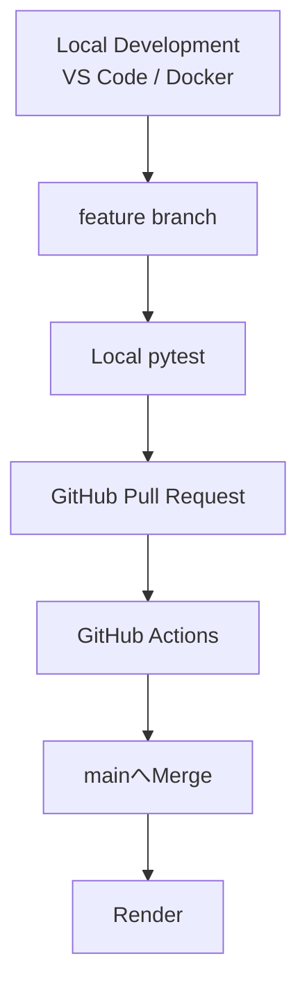

# 🍞 Bakery Hub | Bakery Store Operations & Sales Management


> **現場の「困った」を、Pythonで「最適解」へ。**

**2026年10月18日時点：Bakery Hub v3.0の正式レジは切替前の開発・検証段階です。** 写真タッチ式のレジ会計、未同期会計の状態照会、排他集計、切替前監査までコードに実装されていますが、通常の売上入力を本番レジに切り替えた状態ではありません。Guest Demoも従来の日次売上入力を利用します。


**v3.2 Phase 2（本番未公開）:** 独立した `REGISTER_V32_GUEST_ENABLED`（既定false）で、新規Guestが初期商品・共通商品管理・写真登録・オンラインレジ保存を体験できます。会計は自身のDatasetだけに保存し、既存の排他集計へ接続します。Admin正式レジのNO-GOと各本番ゲートは維持します。[調査・仕様・残課題](docs/v3.2-guest-register-phase2.md)。

**v3.2 Phase 3（開発中・本番未公開）:** Guestレジの会計を端末へ記録した後、同じ会計キーのサーバー保存が照合できた場合だけ「売上分析を見る」を表示します。既存の期間別売上・返金集計と年月別AI分析を再利用し、Guest間のDataset分離を検証しました。[実装と検証記録](docs/v3.2-guest-sales-analysis-phase3.md)。

**Bakery Hub** は、モデル店舗「パン工房 ひだまり」のバナーがある店舗運営ホームで今日の状況と次の予定を確認し、スケジュール・スタッフとシフト・仕込み管理・月次商品登録・売上入力・分析、材料発注リスト・店舗メモ・タスクへ移れる業務支援Webアプリケーションです。

スマホのホームは次の予定と天気を2列で示し、今日のスケジュールと本日の売上を全幅カードで確認できます。ホームの見出しはモデル店舗名「パン工房 ひだまり」で、バナーとBakery Hubのシステム名も表示します。本日の売上は現在のAdminまたはGuestのDatasetについて、日本時間の当日分を既存集計で計算します。売上行がない日は「未入力」、行があって合計0円の日は「¥0」と表示し、カードから売上分析へ進めます。

ホームの **BakeryNews** は、[農林水産省](https://www.maff.go.jp/j/press/)・[食品新聞のパン分野](https://shokuhin.net/category/kakou/seifun/%E3%83%91%E3%83%B3/)・[食品産業新聞社](https://www.ssnp.co.jp/)の公開RSSから、関連する直近30日以内の見出し・公開日・出典・リンクを表示します。見出しの話題で分類し、公開日の新しい順に整理します。取得は情報源ごとに30分キャッシュし、失敗した情報源があっても残りの記事を表示します。古い記事や重複を除き、記事本文の転載・ニュースからの消費者心理の断定は行いません。

サイドメニューの「ニュース・AI分析」（`/bakery-news`）に、BakeryNewsの記事一覧とPuoppoの検索語引き渡しをまとめています。ホームはBakeryNewsカードを入口とし、Puoppoの単独カードは置きません。Puoppoのバックエンド・ログイン・分析処理は独立しています。初期状態では分析連携を無効にし、管理者へも実行ボタンを表示しません。Puoppo側でGoogle認証、許可メール、CSRF、日次回数制限を有効化・確認した後に限り、Bakery Hubの `PUOPPO_INTEGRATION_ENABLED=true` を検討できます。有効時もBakery Hubからは検索語をPuoppoのトップへ引き渡すだけで、Puoppoへログインした本人が分析を実行します。Guestからの引き渡しは無効です。分析はニュース見出しから推測した話題や不満傾向であり、世論調査ではありません。

必要なときだけGemini APIへ経営アドバイスを依頼できます。

販売・飲食・物流の現場経験とWebデザインの知識をもとに、

**老若男女が迷わず操作でき、ヒューマンエラーを仕組みで防ぐ、現場目線の業務システム**

を目指して開発しています。

## ホームカードと当日・週間予報（v3.1 Phase 2B）

現在・次の予定、今日のスケジュール、Adminの出勤予定、BakeryNewsはカードの空白部分からも一覧へ進めます。既存の予定詳細・新規登録・スタッフ登録・記事リンクは個別の行き先を優先します。CSSで既存の主リンクをカード全体へ広げており、リンクの入れ子やJavaScriptによる二重遷移はありません。本日の売上を維持し、「次の作業へ」は商品一覧・販売・店舗メモの48px以上のボタン型リンクにしています。販売先は既存の公開切替条件に従います。キーボードでは各リンクをTabで選んでEnterで移動できます。

「今日の天気」カードは地域・区分・アイコンと、提供された場合は今日の日内最大降水確率を示します。カード全体から専用の `/weather` へ進み、当日の予想気温・降水確率・対象時間帯、当日を含む最大7日間、出典、予報対象時刻と取得時刻（JST）を確認できます。スマホでは日別の縦一覧、広い画面では自動折返しのグリッドです。取得できない数値は「未提供」と表示します。

| 提供元 | 気温・天気 | 降水確率 | 条件 |
|---|---|---|---|
| MET Norway Locationforecast compact | 同じレスポンスの時刻別気温をJST日付で集計。全24時間が揃わない日は「取得分最高／最低・時間帯限定」。揃った日も時刻別予想値の最大・最小。アイコンは正午に最も近い提供時刻の予報で、代表時刻を併記 | 日本向けglobal compactでは未提供。降水量から代用しない | 提供期間から最大7日。先の日は6時間間隔などのため全日の極値を保証しない |
| Open-Meteo | JSTの日別最高・最低・天気コードを同じリクエストで7日指定 | 提供された日内最大値のみ（未提供は補完しない） | 既存の商用キー設定、またはローカル非商用設定のみ。新しい契約・キーは不要 |

気象情報は予報／モデル推定で観測記録ではありません。気象庁モードは広島県の公式予報を一次細分区域と府県週間予報の別々の区域名で表示します。MET NorwayのExpires、条件付き再取得、圧縮・応答サイズ上限、タイムアウト、10分以上のキャッシュも維持します。詳細ページは既存のキャッシュと取得結果を使い、DBを追加しません。MET Norwayの時刻別の朝と午後が十分揃い、両時間帯の単純な天気区分が一致する場合のみ「晴れのち雨」などを表示します。既存のCSRF付き予報記録POSTはMET Norwayの当日最初の直近予報だけを従来どおり保存し、気象庁予報・週間予報を履歴へ書き込みません。未設定・失敗時も他のホーム機能は利用できます。

実装は `current_weather.py`（既存取得とキャッシュ）、`home_forecast.py`（日別の検証・集計）、`static/home_weather.js`（表示用書式）、`static/store_home.js`（ホーム表示）、`static/weather_detail.js`（専用ページ表示）です。合成データのpytest／Nodeテストと、390px・タブレット横向き・1280pxのChromium E2Eで確認します。実機での今回のカード操作・予報表示は別途確認が必要です。

提供元の一次資料：[METデータモデル](https://docs.api.met.no/doc/locationforecast/datamodel.html)、[利用条件](https://docs.api.met.no/doc/TermsOfService.html)、[ライセンス](https://docs.api.met.no/doc/License.html)、[Open-Meteo予報API](https://open-meteo.com/en/docs)、[利用条件](https://open-meteo.com/en/terms)。MET Norwayを出典表示し、CC BY 4.0に基づく分類・日別集計である旨を示します。Open-Meteo無料APIの商用利用を有効にする変更はありません。

## 商品・写真・レシピのCSVバックアップ

独立CLI `data_vault.py` は、Adminの商品名・単価・分類・販売状態・表示順・写真、レシピ・材料・商品との対応だけをローカルへ保存し、スキーマ準備済みの空Admin Datasetへ復元します。管理画面やDocker起動処理には組み込みません。既定はdry-runで、書込には復元先Datasetの明示確認が必要です。内部IDを対応づけ直し、途中失敗は全体rollback、保存後はDBから読み戻して照合します。

保存形式はUTF-8の4 CSV・写真・件数とSHA-256を持つManifestです。写真は再圧縮せず、CSVの日本語・改行・引用符を保持し、数式対策用のアポストロフィを読込時に取り除きます。商品写真はWebPの元内容を復元し、レシピのstatic画像には復元先の同じ承認素材が必要です。

**実売上・会計・返金・価格変更監査履歴・日次売上・個人情報・認証・未同期会計は対象外です。DB全量バックアップの代わりにはなりません。** 無料DBの期限前に承認した作業窓で最終保存し、以後の更新と別途の本番移行を区別します。Private GitHubへの自動push・DB切替は行いません。実データの書き出し・アップロードは別途承認が必要です。

[保存・dry-run・復元の手順と制限](docs/data-vault-guide.md)／[Private保管庫の初期構成（架空データのみ）](docs/data-vault-template/README.md)。Phase 7の正式レジ公開判定はNO-GOを維持します。

`seed_demo.py` は旧商品・旧売上で投入要否を判断します。通常のDocker起動からは外し、復元済みDBでは実行しません。明示的な保守操作は [Web起動とDB保守の分離](docs/startup-maintenance.md) を参照してください。

## レジの端末別レイアウト（2026-10-20）

| 表示領域・操作 | 商品表示 | 移動 | 会計 |
|---|---|---|---|
| スマホ・850px以下 | 販売中の全商品を2列。ページ・カテゴリ分割なし | 本文の縦スクロール | 合計付き下部固定「会計へ」からキーパッド直上へ移動 |
| 横長タッチ端末・851px以上 | 利用可能な高さと幅から計算した正方形タイルを2行 | 商品領域だけ自然な横スクロール。吸着なし | 右側固定。明細だけ縦スクロール |
| マウス中心のPC・851px以上 | 高さに応じて2〜4行。読みやすい大きさを確保できる場合は3〜4行 | 必要な場合だけ商品領域を横移動。前次・左右キーも利用可 | 右側固定。明細だけ縦スクロール |

スマホの写真は縦横比を維持し、名前2行・価格・48pxの−と数量入力を分けます。＋ボタンは増やさず、タイルを押すと1個追加します。会計操作中は固定ボタンを隠してキーパッドと完了操作を覆わず、「商品一覧へ戻る」で元の縦位置と商品のフォーカスへ戻れます。今回このスマホ操作・レイアウトは変更しません。

横長画面でも内部グループは最大12商品ですが、未登録枠は最後の縦1列を揃える不足分だけです。タブレット2行では最大1枠（0→0、1→1、6→0、12→0、13→1、18→0、24→0、25→1）。PCの3〜4行でも最大2〜3枠です。商品0件は従来の案内を表示します。空き枠には商品ID・写真・価格・入力・ボタン・フォーカスがなく、`aria-hidden`で読み上げ対象から外し、商品数・数量・会計に含めません。スマホでは生成しません。数量操作で一覧DOMや横位置を再構築せず、行数変更時も実商品DOMは保持します。

`register_layout.js`は会計状態に触れない表示専用の処理です。`innerHeight`と`visualViewport.height`の小さい方から、ヘッダー・通知・外枠・商品見出しの実測高を引きます。タッチ主体（`pointer:coarse`）は2行、マウス主体は最低タイル寸法を確保できる2〜4行です。タイルの一辺は残り高さ÷行数と商品領域の幅から計算し、最低168pxまたは標準文字サイズの10.5倍を確保します。CSSの`dvh`を初期値・代替に使い、回転・リサイズ・可視領域・表示内容の変化に追従します。伸縮後の明細やグリッドの高さを必要高さの根拠にしないため、表示が往復する判定を避けます。

横長画面のテンキーは数字3列の右に削除・クリア・00を置く4段です。0は横長、00は縦長で、操作ロジックとキーは従来のままです。数字・クリア・削除の高さは実測した会計操作部に応じ52〜60px、会計完了は56pxを確保します。合計・預り・お釣りと余白をコンパクトにして、必要時はキーを60pxから52pxまで調整します。明細なしの重複案内は横長画面で省き、見出しの「商品を選択してください」を残します。明細ありでは最低28pxまたは先頭明細の実測高を確保し、実際の明細量に応じた高さだけを使います。余った画面高で明細欄を引き伸ばさず、会計操作部を除く残り高さを上限にして内部スクロールします。説明の重複は減らしますが、練習用・未保存、保存失敗・同期異常・未同期件数は隠しません。

横長画面ではヘッダーを36pxにし、戻る・前次ボタンは44pxのタッチ領域を保って見た目を32pxに圧縮します。長文の説明帯は常時表示せず、デモは「練習用・未保存」バッジ、通常画面は正式／開発用・未公開／保存停止／端末内レジの状態表示と同期件数を残します。商品見出しは短いヒントと前次・位置表示を1行へまとめます。スマホでは長文説明を含む既存表示を維持します。

合計上の太い線と余白、お釣り上の線を除き、お預かりラベルと金額欄を同じ行へ配置します。空き明細が合計を下へ押さないようにします。保存失敗・未同期一覧・保存結果・PIN解除や認証の異常は隠さず、文字サイズを保って行間と上下余白を詰めます。必要高さの判定も空明細の固定44pxや固定12pxのスクロール余裕をやめ、実際の明細行とスクロールバー寸法（最低8pxの余裕）を使います。必要高さを切り上げ、可視高さを切り下げて比較し、一律2pxの追加余裕だけで物理的に収まる画面を縦退避させないようにします。

通常サイズは1画面に収め、本文の`overflow:hidden`で重要操作を切り捨てません。最低タイル・キー・明細を確保できない低い画面、文字拡大、長い警告は案内とともに本文の縦スクロールへ戻します。端末準備・保存状況はヘッダーのダイアログで確認できます。通常ChromeとPWAで表示モードによる分岐はなく、実際の可視画面高を使います。

通常レジ・非保存デモ・PIN解除後のオフラインレジに同じ表示制御を適用します。資産URLは`?v=trim-6`、専用Workerのキャッシュは`register-offline-v6-trim`です。旧キャッシュ・IndexedDB・未同期会計は削除せず、強制activate・自動リロードも追加しません。既存の更新待ち案内と全レジウィンドウを閉じて再準備する手順を維持します。Manifest・PWA scope・アイコン・DB・認証・会計計算・保存形式は変更しません。

ChromiumのCSS viewport実測は、下の表へ今回の検証結果を記録します（端末の物理画素ではありません。標準文字16px・タッチ主体）。

| CSS viewport・状態 | ヘッダー | 商品領域開始Y | タイル一辺 | 写真枠高 | 数字キー高 | 完了高 | 本文縦超過 |
|---|---:|---:|---:|---:|---:|---:|---:|
| 1024×500・デモ1商品 | 36px | 46px | 182px | 92px | 52px | 56px | 0px |
| 1024×533・デモ1商品 | 36px | 46px | 198px | 108px | 60px | 56px | 0px |
| 1024×540・デモ1商品 | 36px | 46px | 202px | 112px | 60px | 56px | 0px |
| 1280×552・デモ1商品 | 36px | 46px | 208px | 118px | 60px | 56px | 0px |
| 1280×600・デモ1商品 | 36px | 46px | 232px | 142px | 60px | 56px | 0px |

オフライン保存後の3通知（未同期一覧・保存結果・端末解除済み）を残した1024×552でも、本文縦超過0px・数字キー53pxを確認しました。商品タイルは168pxを確保し、完了ボタン56pxの設定を維持します。

同じ低い表示領域で通常プレビューも検証し、10明細・スマホ4幅・回転・文字拡大・長いエラー・PWA・オフライン保存／再同期もChromiumで確認しました。上の数値は本検証環境の測定値で、実機成功を意味しません。

変更前の1280×552・非保存デモでは本文が79px超過、商品領域開始Y=123.19px、ヘッダー44pxでした。これはPR #129で最小600pxまで確認した条件より低い表示領域です。長文説明帯、縦退避時の説明帯、空明細44px、金額上の余白・罫線が重なっていました。今回の圧縮ではヘッダー36px、商品領域開始Y=46pxにし、ボタンや商品写真を優先します。

画像は従来の`object-fit:contain`を維持し、写真・名前2行・価格・48pxの−と数量入力を変更しません。ユーザー報告ではPR #128のスマホは良好、PR #129の2行版でもsvitoo P10の縦スクロールは残っていました。**今回のtrim-6修正は実機未検証です。svitoo P10の実際のCSS viewport、OS文字サイズ、通常Chrome／PWAでの確認を待ちます。正式レジの本番切替はNO-GOです。**

## ホーム画面から起動するPWA（2026-10-19）

PWA（Progressive Web App）は、Webアプリを端末のホーム画面などへ追加して、アプリのように起動する利用方法です。Bakery Hub全体を一つのアプリとして扱い、スマホ・タブレットでURLの入力やタブの選択を減らします。ホーム、売上分析、商品・仕込み・スタッフ・予定・発注・メモ・タスク、レジは、既存の画面と認証をそのまま使用します。同じリポジトリにある他アプリは変更しません。

**正式レジの本番切替は引き続きNO-GO。PWAのインストールは、全機能のオフライン化・正式レジの有効化・自動ログインを意味しません。** 本番へ反映する操作は別途の承認が必要です。PWAの実機確認はユーザー報告で異常なしです。端末別の詳細条件は未記録で、今回の端末別レジUIとiOSは実機未検証です。

### Androidで追加・起動する

1. AndroidのChromeで、HTTPSのBakery Hubを開きます。アプリ内ブラウザやシークレットモードを避け、通常のChromeを使います。
2. Chromeの「⋮」メニューから「アプリをインストール」または「ホーム画面に追加」を選び、表示名が **Bakery Hub**、麦のアイコンになっていることを確認して追加します。文言や追加方法はOS・Chromeの版により異なります。自動のインストール案内は保証しません。
3. ホーム画面のBakery Hubアイコンを押します。既存の `/home` から起動し、未ログイン・セッション期限切れの場合は従来の `/login` へ進みます。既存のAdminログイン・Guestデモを選択してください。インストール自体は認証や権限を付与しません。
4. 通常のURLバー・タブを省く `standalone` 表示を確認します。Androidのシステムバーやアプリ切り替えはOS側の動作を維持します。画面の縦横を固定しません。通常のChromeタブからの利用も引き続き可能です。

インストール項目が見つからない場合はHTTPS・通常モード・Chromeの版・管理端末の制限を確認します。インストール済みの場合は同じアイコンを使用してください。ブラウザによっては通常のショートカットになるため、実機でアイコン起動後の表示を確認する必要があります。

iPhone / iPadではSafariの共有メニューから「ホーム画面に追加」を選びます。「Webアプリとして開く」が表示される場合はオンにして追加します。これは[Appleの案内](https://support.apple.com/ja-jp/guide/iphone/iphea86e5236/ios)に基づく手順で、Bakery Hubの実iOSでの起動・セッション共有・レジ保存は未検証です。Cookieや保存領域の共有、表示方法はOS・ブラウザにより異なります。

### 実装構成と認証

| 設定・資産 | 内容 |
|---|---|
| `static/manifest.webmanifest` | アプリ名・短縮名 `Bakery Hub`、`lang: ja`、`display: standalone` |
| `id` | `/bakery-hub`。アプリ識別用の固定値。ページのURLではなく、起動先は別途指定 |
| `start_url` / `scope` | `/home` / `/`。このFlaskアプリはルート直下の複数URLを使うため、同一オリジン全体をアプリ内として扱う。GitHubリポジトリ全体を対象にする設定ではない |
| 背景色 / テーマ色 | `#fff8ec` / `#72583b`（既存の店舗ホームの茶色） |
| `templates/_pwa_head.html` | ログイン、主要画面、子画面の共通ベース、情報を含まないレジ用シェルが同じManifestを参照。既存レイアウト・リンク・戻る処理は変更しない |
| `static/pwa/` | PNGの192px・512px、maskable 512px、Apple用180px。角切りをOSに任せる不透明の正方形。麦の重要部分は中心から半径40%の安全領域内 |
| `static/pwa/icon-source.svg` | 既存の共通ナビゲーション・ひだまりバナーの麦とホームの配色を基にした専用ベクター原稿。小さいアイコンでも見分けやすいよう文字を省略 |

Manifest・アイコンは業務データを含まない公開の静的資産です。認証済みHTML・APIは既存の `Cache-Control: no-store` を維持します。ログアウトは従来のCSRF付きPOST、Admin・Guest認可とDataset分離も既存のままです。外部サイトは別のブラウザへ移動する場合があります。将来このオリジン直下に別アプリを同居させる場合は、`scope: /` の見直しとURL設計が必要です。

### オンライン利用・レジ用Service Worker・更新

**今回アプリ全体用のService Workerは登録しません。** [Chromeチームのインストール要件](https://web.dev/articles/install-criteria)と[メニューからのインストールに関する説明](https://developer.chrome.com/blog/update-install-criteria)を確認し、Manifest方式を選びました。Service Workerは通信を扱う仕組み、Manifestはインストール後のアプリ名・起動・表示を伝える設定で、役割が異なります。インストールを目的に認証画面や売上APIをキャッシュするWorkerを足しません。

- 既存Workerの登録URLは `/register/offline-sw.js`、scopeは `/register/`。登録は従来のAdmin端末準備操作時だけで、機能フラグと端末許可の条件を維持します。新しい登録との範囲重複・優先関係は生じません。
- `register_offline_sw.js` の版・キャッシュ対象・更新方法は変更しません。Cache Storageは情報を含まない専用シェル、許可されたレジ資産などの保存先です。認証済みプレビューHTML・Cookie・売上API・認証APIを追加保存しません。IndexedDBは暗号化済み準備情報・下書き・未同期会計を保持する別の保存先で、初期化・削除しません。
- ホーム・通常の業務画面はオンラインで使います。準備済みレジの専用URLからの通信断復帰、PIN、期限付き端末許可、会計の端末保存・再同期は従来どおりです。オフラインでアプリアイコンを押してホームからレジへ進めることは保証しません。端末準備していないレジもオフライン化されません。
- 通常画面はオンラインで再読み込み・開き直すとサーバーの最新版を取得します。Manifest・アイコンの反映時期はブラウザ・OSによります。アイコン名や絵柄が即時更新される保証はありません。通常画面の更新のために再インストールする必要はありません。
- レジ用Workerの更新待ちは従来の案内に従い、会計を端末保存して未同期記録を確認し、全レジタブ・ウィンドウを閉じて開き直してから再準備します。`skipWaiting`による強制更新・自動リロードは追加しません。既存端末のキャッシュ済みシェルには、既存の再準備まで新しいPWAメタ情報がない場合がありますが、未同期会計は保持します。
- 更新・トラブル対応のためにサイトデータ、IndexedDB、Cache Storageを削除しないでください。アンインストールやブラウザの保存領域整理も未同期データへ影響し得るため、未同期会計を残したまま行わないでください。PWAはネイティブアプリではなく、ブラウザ側の保存容量・削除ポリシーに従います。

アイコン原稿の再出力は、開発用のCairoSVGで各サイズのPNGを生成できます（本番依存は追加しません）。例：`cairosvg static/pwa/icon-source.svg -o static/pwa/icon-192.png --output-width 192 --output-height 192`。他の3サイズも表の寸法へ出力し、絵柄・不透明背景・maskable安全領域を確認します。

### 確認方法・制限

- 関連pytest：`pytest tests/test_pwa.py tests/test_auth.py tests/test_authorization.py tests/test_logout.py tests/test_system_overview.py tests/test_register_demo.py tests/test_register_offline.py`。ManifestのMIME・内容、アイコン取得と寸法、主要画面設定、既存の認証・権限・非キャッシュを確認します。
- JavaScript：`node --test tests_js/*.test.cjs`。既存の計算・キーパッド・スクロール・端末保存の保証を確認します。
- Chromium：`npx playwright test --config=tests_e2e/playwright.config.cjs`。`pwa.spec.cjs`でManifestのブラウザ解析、同じウィンドウ内の遷移・更新・戻る、ログアウト・セッション喪失、通常画面のWorker未登録と通信断時の非キャッシュ、レジ用Workerだけの登録範囲、未同期会計を持ったホーム往復と再読み込みを確認します。既存のレジE2Eも実行します。
- DevToolsのApplication → Manifestでname・id・start_url・scope・アイコン・displayを確認します。Service Workersでは通常画面に新しい登録がないこと、準備済み端末では `/register/` のみであることを確認します。Cache Storageに `/login`・`/home`・売上APIが追加されていないことも確認します。
- 対象はHTTPS上のAndroid Chrome（svitoo P10とAndroidスマホを優先）。PCのChromium系でも設定を利用できます。HTTPのLAN内アドレスではインストール機能やWorkerを利用できないことがあります。localhostでの自動テストは、本番HTTPS・端末のインストールを代替しません。

PWA自体はユーザーによる実機確認で異常なしとの報告を受けています。今回のレジUI変更はスマホ・svitoo P10とも実機未確認です。以下は端末別に確認結果を残す項目です。インストール → アイコン表示 → アイコン起動 → URLバー・タブなし → ホーム／ログイン → 主要機能 → 戻る → 終了・再起動 → セッション期限切れ → レジ操作デモを確認してください。縦向きスマホ・横向きタブレットを両方確認します。実iOS、OSの戻る操作、システムバー、WebAPKとしての導入結果も未確認です。

PR #127ではレジのヘッダー・縦スクロール調整を範囲外にしていました。現在の端末別レジUIは上の最新仕様を参照してください。記事本文はまだ作成せず、この構成・手順・制限を技術記事化の基礎記録にします。

## 商品管理統合・端末別レジ表示（2026-10-19更新）

正式レジの本番切替は引き続き **NO-GO**。この変更は作業ブランチの実装であり、本番DB・Render設定・機能フラグは変更しない。以下を現行仕様とし、後述のPhase別記録に残る「500円上限」「18品必須」「独自商品別枠」「画像アップロードなし」は当時の実装記録として読む。

- Adminの商品管理フラグが有効な環境では、`/products` の「商品一覧」を入口にする。旧 `/register/products` と旧月次登録 `/` のGETは商品一覧へ案内する。旧月次登録は一覧内の履歴用リンク（`/?legacy=1`）から参照可能。Guestの月次登録・日次売上入力は変更しない。フラグ既定OFFの環境は従来画面を維持する。
- 正本は既存の `RegisterProduct`。パンの種類（8種類）と商品分類（定番・季節もの・特別商品）、写真、価格、`is_active`を同じIDで管理する。既存行の分類は推測せず「その他・定番」を初期値とする。必要な商品を店主が分類する。
- 新規登録・編集は同じ写真中心のフォーム。承認済み画像、写真ファイル、スマホ撮影を受け付け、名前・価格・分類とともに確認ダイアログを表示する。写真なしなら文字タイルを維持する。
- 写真は既存 `catalog_repository.validate_image()` で拡張子・MIME・実画像・10MiB上限・画素数・単一フレームを検証し、メタデータを除いて500KiB以下のWebPへ変換。`RegisterProduct.photo_webp` に保存し、Renderの一時ファイルへ置かない。既存承認画像は `image_key` のまま使い、新規写真と同時に二重保持しない。認証済みの所有Datasetだけが写真URLを読める。写真の保存量は商品数に比例するため、DB容量とバックアップ容量も運用時に確認する。
- 終売は `is_active=False`。一覧下部に残し、新規レジのカタログから除く。同じID・写真・分類・価格履歴・仕込み対応・過去売上のまま、価格確認後に再開できる。通常UIに物理削除はない。
- 18商品は初期候補。管理画面やAdminレジのGETでは生成しない。確認付きPOSTだけが不足候補を追加する。既存品の変更や終売解除はしない。内部 `template_key` とGuest開発プレビューの初期化互換性は維持する。18品すべての登録・販売を切替条件としない。
- 新規登録はUUID送信キーと内容digest（写真・分類も含む）で再送を識別する。更新・終売・再開は署名したDataset・商品ID・版番号、Datasetロック、CSRFで保護する。同一更新の直後の再送は許容し、別編集や終売→再開後の古いフォームは409で拒否する。価格変更時だけ `RegisterPriceHistory` に追記する。
- 商品単価は整数 **0〜100,000円**。商品、価格履歴、会計明細、復旧明細、同期時の表示価格照合に同じ上限を適用。数量±50・1会計50商品・会計合計の既存上限は維持する。0円合計会計は保存不可。既存の承認価格資料や実売価は推測で変更しない。
- レジはスマホ幅（850px以下）で全商品を2列・縦スクロール表示し、合計付き下部固定「会計へ」からキーパッドへ移動して元の商品位置へ戻る。851px以上は実際の表示高と操作方式から、タッチ主体は2行、マウス主体は読みやすい寸法を保てる2〜4行とし、正方形タイルを商品領域だけ横スクロールする。内部グループは最大12商品、未登録枠は最後の縦1列を揃える分だけ（2行なら最大1枠、0商品は0枠）。空き枠は商品ID・操作・入力・フォーカスを持たず、aria-hiddenで読み上げから除く。写真全体・名前2行・価格・48pxタッチ領域の−と数量入力・タイル全面タップ＋1を維持する。横長画面のテンキーは4段・52〜60px、会計完了は56px。ヘッダー・通知・会計部を実測して1画面へ調整し、収まらない低い画面や文字拡大では重要操作を隠さず本文縦スクロールへ退避する。数量操作で一覧を再構築せず、回転・行数変更でも商品DOMと会計状態を保持する。
- タブレットの右会計は明細だけがスクロールし、合計・預り・お釣り・完了を常時操作できる。ヘッダー・説明を小さくし、商品見出しの横に前後操作を配置する。表示専用register_layout.jsが実際の要素高と可視画面高を測り、収まるときだけ1画面へ配置する。低い画面・文字拡大・長い警告は通常の縦スクロールへ戻し、操作をoverflowで隠さない。端末準備・保存照会はヘッダーから開くダイアログへ移し、要確認・失敗・同期状態の通知と破棄確認を維持する。
- `register_cash_pad.js`は0〜9・00・C（全消去）・末尾1桁削除を提供する。金額は円単位・桁区切りで表示し、入力欄やソフトキーボードへの操作は不要。キーパッド内ではPCの数字・Backspace・Delete/Cも使える。先頭ゼロを正規化し、整数0〜1,000,000,000円を受け付け、上限超過は元入力を保持して通知する。既存inputイベントを経由して計算・下書きを更新する。会計完了後はリセット、返金では預り操作を隠し、処理中やデモ完了後はキーパッドを無効にする。
- スクロール処理は会計状態に触れない。数量・預り・釣銭・返金を維持する。非保存デモも同じスクロールとキーパッドを使うが、保存用JSを読まない。オフラインシェルはv4の同じ版のキャッシュから表示制御・キーパッドを読み込み、旧キャッシュや未同期キューは削除しない。資産URLにも同じ版番号を付け、旧Workerが更新待ちの場合は準備完了にせず、全レジタブを閉じて再準備するよう案内する。強制activateはしない。
- オフライン準備時は写真をdata URLとして既存の暗号化カタログ内に含める。認証付き写真をService Workerの公開画像キャッシュへ追加しない。元会計の価格・スナップショット・営業日・送信キー・未同期記録をページ操作やマスタ変更で更新しない。既存の署名商品版によるオフライン受入、通常会計の価格差・要確認・再送防止を維持する。オフライン自動受入は既存の1会計50,000円までを維持し、それを超える会計は元記録を残して管理者確認へ回す。
- 旧 `Product`・`DailySales` に自動移行・同名統合・金額更新・削除はしない。旧商品のコピーは明示確認した別IDとして登録し、売上自体はコピーしない。既存の `RegisterPrepLink` と標準品のレシピキーは変えない。

### スキーマとマージ前の停止条件

単一head `b6d2e9f4a107`、親 `a3c9d7e5f102`。既存表に `bread_kind`・`product_class`・`photo_webp`・`revision` を追加し、4表5価格制約を拡張する。旧Product・DailySalesと既存明細の値は変更しない。SQLiteの表再構築後は価格履歴・復旧明細の追記専用トリガーを再設定する。downgradeは新分類・写真・版番号・500円超の価格、またはレジ証拠行が存在すればDDL前に拒否する。データを削除してdowngradeしない。

**通常のDocker起動はmigrationを実行しない。** DB revisionがコードと異なる場合はWeb起動を拒否します。本番反映にはバックアップ・別DBへの復元・稼働revision・停止時間を確認し、明示的なmigration承認と適用が必要です。


---

## 🚀 オンラインデモ

### [👉 Bakery Hubを体験する](https://bakery-salesdata.onrender.com/)

スマートフォン・PCのブラウザからアクセスできます。

現在は、管理者アカウントを公開せずに実際の業務画面を操作できる  
**Guest Demo** を公開しています。

ログイン画面の

```text
ゲストデモを体験する
```

から体験できます。

ログイン画面は **Tosane WorksのWeb Portfolio入口** も兼ねています。
Store（オレンジ）・Information（水色）・Logistics（緑）のカテゴリごとに作品を表示し、各READMEへ移動できます。Puoppo・Driver Personality TestにはLive Demoへのリンクもあります。Bakery HubのGuest Demoと管理者ログインはStore内に配置しています。

Guest Demoでも、

```text
ホームで今日の予定を確認する
      ↓
商品を登録する
      ↓
日次売上を入力する
      ↓
売上ランキング・グラフを見る
      ↓
材料発注リスト・店舗メモ・タスクを使う
      ↓
Geminiへ経営アドバイスを依頼する
```

という実際の業務フローを操作できます。

Guestと旧入力用の月次商品登録は標準18種のテンプレート選択と自由入力に対応しています。Admin専用のCatalog商品申請・画像アップロードはGuestには公開しません。

店舗メモツールでは、現在 **材料発注・メモ・タスク** を利用できます。  
タスクでは、追加・完了 / 未完了・削除・複数選択・長押し並び替えを操作できます。

### レジv3.0の開発状況（本番レジ未公開）

> [!IMPORTANT]
> PR #120までの段階実装はmainへマージ済みですが、**本番切替の完了や、公開Guest Demoでの正式レジ会計を意味しません**。従来の「日次売上入力」は引き続き現在の運用経路です。

| 機能・工程 | `main` の実装状況 | 通常の本番公開 |
|---|---|---|
| 共通商品マスタ | 写真・価格・パンの種類・商品分類・終売と再開、旧商品の明示的コピー | 正式レジ向け商品管理は既定で無効 |
| 写真タッチ式レジ | 軽量WebP、数量、預かり・お釣り、販売・返金を実装 | 正式会計画面と保存は試験環境向け・既定で無効 |
| 会計保存と未同期キュー | Dataset認可、二重登録防止、IndexedDB保存、再送・要確認を実装 | 正式会計の本番利用は不可 |
| 旧新売上の統合集計 | Dataset別切替境界、返金、会計件数、読取整合性を実装 | 通常の本番集計切替は未実施 |
| 商品一覧への管理統合 | 写真付き登録・編集・終売・同一IDでの再開。レジは同じ商品を読取 | 試験用フラグで制御 |
| 仕込み販売実績の参考表示 | 確定会計の販売数量を参考表示、予定や材料を自動変更しない | 新レジ連携は条件付き |
| Admin用レジ操作デモ | `/register/demo` で標準18品を用いた非保存練習 | 独立フラグは既定で無効。Guest利用不可 |
| 切替前監査・切替承認 | `/register/readiness` は読取監査。別の明示POSTはDatasetロック後に再監査して切替日・承認記録を保存 | Admin専用で既定無効。本番では未実施 |
| 未同期会計の保存状況確認 | 同じ送信キーと会計内容の一致を確認し、不一致は要確認へ | 過去日への自動強制保存は行わない |
| 独自商品と仕込みレシピ対応 | Adminによる明示的な一対一紐付け | 既定無効・専用migrationが必要 |

**Phase 5Cでは**価格履歴、本番用のAdmin認可と機能フラグ、切替日確定処理、根拠を確認する過去日復旧経路、PIN付きオフライン起動用シェル、承認済み翌営業日の自動同期を実装しました。端末保存後は通信復旧を待たず次の会計へ進めます。隔離PostgreSQLとChromiumのブラウザ試験は成功しましたが、実スマホ・タブレット、本番バックアップ・復元、全端末確認は未検証です。本番公開可能とは判定していません。

技術設計は[レジv3.0設計書](docs/v3-register-design.md)、実機・端末・バックアップとPhase 7の切替条件は[正式レジ切替手順書](docs/v3-register-cutover-runbook.md)を参照してください。実際の運用開始は別途確認が必要です。

### 店舗運営ホーム・スケジュール

ログインまたはGuest Demo開始後は、商品登録とは独立した **ホーム** を開きます。今日の予定を時刻順に確認し、開始時刻・終了時刻のある現在の予定と次の予定を見られます。予定は登録・編集・削除でき、日本時間で表示します。ホームを開いたままでも時計と予定を更新します。時刻が来ただけでは予定を完了扱いにしません。

天気は設定地点の**現在のモデル推定または直近の予報**を表示します。過去の天気記録とは別の情報です。GPSは使わず、設定や通信が不足する場合は取得できない理由を表示します。地点には `WEATHER_LATITUDE`・`WEATHER_LONGITUDE` を設定し、`WEATHER_LOCATION_NAME` で表示名を指定できます。広島市中心部の例は GeoNames の[広島市地点](https://www.geonames.org/1862415/hiroshima.html)（北緯34.4、東経132.45）です。店舗に合わせて変更できます。

気象庁の広島県予報を利用する場合は `WEATHER_API_MODE=jma` と `WEATHER_JMA_AREA_CODE=340010`（広島県南部）または `340020`（広島県北部）を、店舗の所在地に合わせて明示します。地域名や緯度経度から区域を推測しません。設定を変更しない限り既存モードが動き、本番環境の設定はこのPRでは変更しません。[気象庁の広島県予報JSON](https://www.jma.go.jp/bosai/forecast/data/forecast/340000.json)をHTTPSで取得し、固定URL・6秒タイムアウト・256KiB上限・発表日時／区域／配列整合性検査を通した上で10分キャッシュします。JSONはWeb向けのため形式変更の可能性があります。失敗時は古い予報へ自動的に切り替えず取得不可とします。短期の天気・6時間帯別確率は指定した南部／北部の値、週間の3日目以降は広島県全域の天気・当日確率で、一覧にその区域を表示します。短期の翌日も指定区域の最初の6時間帯を表示し、期間全体の確率には換算しません。気温は別地点の値を区域全体の気温として扱わず、気象庁モードでは表示しません。出典：[気象庁ホームページ](https://www.jma.go.jp/jma/kishou/info/coment.html)（予報を表示用に加工）。気象庁の公開JSONは予告なく変更され得るため、切替時には実際の店舗区域、取得と画面表示を確認してください。

本番で無料の予報を取得する場合は `WEATHER_API_MODE=met_norway` を指定し、`WEATHER_API_KEY` は空欄にします。MET NorwayのLocationforecastは観測記録ではなく予報です。運用時には[利用条件](https://api.met.no/doc/TermsOfService)を守り、画面上で出典と[CC BY 4.0](https://creativecommons.org/licenses/by/4.0/)を示します。識別可能なUser-Agentを付け、地点を小数4桁へ丸め、レスポンスのExpiresまでキャッシュし、再取得時はLast-Modifiedがあれば条件付きリクエストを送ります。直近の予報がない場合や古い場合は天気を表示しません。無料APIの可用性保証はありません。このモードは過去天気の取り込みには対応しません。

MET Norwayの正常な予報をホームで取得したときは、認証・CSRF保護された保存リクエストで、現在のDatasetに日本時間の**その日最初の予報**を1件だけ記録します。予報コード、対象時刻、取得時刻、地点、出典を`daily_forecasts`へ保存します。売上ダッシュボードでは日付単位の売上推移に保存済み天気のアイコンを表示し、選択して詳細を確認します。過去の気象データと予報が同日にある場合、アイコンには過去の気象データを優先し、詳細には両方を表示します。履歴閲覧では気象APIへ通信しません。従来の`daily_weather`（過去の観測・再解析データ）とは別に保存し、双方を上書きしません。**保存値は取得当時の予報であり、実際の観測結果ではありません。** ホームを開かなかった日や取得に失敗した日は記録されません。Guestの記録はDataset期限切れ時に削除されます。

本番では新しいmigrationをデプロイ前に適用する必要があります。既存の`daily_weather`と売上データは変更しません。Render無料PostgreSQLを新しいDBへ切り替える場合、保存済みの予報や既存データは自動移行されず、別途バックアップ・復元が必要です。

Open-Meteoを使う場合は、商用の契約済みAPIキーで `WEATHER_API_MODE=commercial` と `WEATHER_API_KEY` を設定します。Open-Meteoの無料APIは、既存どおりローカルの非商用開発に限る `WEATHER_API_MODE=noncommercial` と `LOCAL_DEVELOPMENT=true` の組み合わせだけで利用できます。公開ポートフォリオの非商用該当性が不明な状態で、本番へ `LOCAL_DEVELOPMENT=true` を設定しないでください。

### スタッフ・シフト管理（Admin専用）

サイドメニューの「スタッフ・シフト管理」から、表示名・担当（製造／販売／兼任／その他）・任意の入社日を登録できます。一覧は名前・担当・在籍状態をコンパクトに示し、行を開いた詳細画面で入社日と編集・退職・復職操作を確認します。退職時は在籍状態を変更し、過去の勤務予定は残します。同姓同名でもIDで区別します。Guest Demoにはメニューを表示せず、URLを直接開いてもスタッフ情報を取得できません。

日別には1人・1業務日につき「出勤予定」「終日（時刻未指定）」「休み」のいずれかを1件登録します。終日は24時間勤務ではなく、開始・終了時刻のない予定です。休み・未登録とも区別します。新規の時刻付き予定は日本時間の同一日内で、開始から終了まで最大12時間（モデル店舗の運用ルール）。時間帯の重複を拒否します。以前登録された翌日終了・12時間超の予定は自動変更せず、詳細表示と備考のみの編集では元のUTC日時を維持します。時刻を変更する場合は新ルールを適用します。PCは月間カレンダー、スマホは横スクロールの日付選択とコンパクトな日別一覧を使い、行を開くと備考・編集・取り消しの詳細画面へ進みます。これは**予定の管理**であり、勤怠打刻や勤務実績ではありません。

Adminホームの「今日の出勤予定」は、既存の `planned_work_for_day()` を使って、認可済みAdmin Datasetと `business_today()` のJST業務日に登録された出勤・終日予定を読みます。休みは人数に含めず、終日は「終日（時刻未指定）」、既存の翌日終了はその旨を表示します。4人までをコンパクトに並べ、残り人数とシフト表へのリンクを示します。スタッフ未登録と本日の予定なし、DB取得失敗は別の文言です。Guestはスタッフの検索も表示も行いません。表示は予定であり、実際の出勤や勤務中を意味しません。ホームのGETはスタッフ・シフト情報を書き換えません。

保存先は`shop_staff`・`shop_shifts`テーブルで、`ShopSchedule`とは独立しています。新revision `d5a9f1b7c204` は `c8e6a1b9d4f2` の後に適用し、`shop_shifts` のCHECK制約だけを拡張します。既存行の時刻と状態は維持します。本番反映前にバックアップと現在のAlembic revisionを確認し、先にmigrationを適用してから新コードを起動してください。通常のDocker起動ではmigrationを実行しません。適用は独立した保守操作とします。このPRでは本番DBへ適用しません。終日予定が残る間のdowngradeはデータ損失を避けるため拒否されます。さらに以前のrevisionへのdowngradeはスタッフ・シフト表自体を削除するため実行しないでください。

### 仕込み管理（Admin専用）

仕込み画面の「レシピを登録・編集する」から、標準18品・承認済みAdminテンプレート、または登録済みのオリジナル月次商品を選び、基準個数、材料名・使用量・単位（g / ml / 個）、仕込みメモを登録します。配合の自動生成はしません。テンプレートは安定したキー（`template:<key>`）、自由入力の商品は選択した月次ProductのID（`product:<id>`）を識別子に使います。商品名が同じというだけで統合せず、レシピは月次Productから独立しているため翌月以降も使えます。別月に同名の自由入力商品を登録した場合は、既存レシピを仕込み画面から使い、商品名による自動関連付けはしません。

サイドメニューの「仕込み管理」（`/prep`）ではJSTの今日を開き、①パンを選ぶ → ②製造個数を決める → ③必要材料を見る、の順に操作します。保存済み予定は日付ごとに復元し、複数商品を**まとめて保存**できます。選択を外すだけでは保存済み予定を削除せず、0個も予定として保存できます。削除は折りたたみ内の明示的な操作です。レシピの登録・編集は別の「レシピ管理」（`/prep/recipes`）で行い、従来の `/prep/plans` と単品保存URLも利用できます。

個数は±ボタンで現在値から10個ずつ調整でき、数字欄をタップすれば1個単位の任意の整数（0～1000個）を直接入力できます。端数を10の倍数に丸めず、範囲の端では0または1000で止まります。JavaScriptがその場で材料を試算し、未保存の変更を示します。サーバーは選択したレシピIDと個数を全件検証し、一度のtransactionで更新またはrollbackします。Pythonでは `Decimal` で `使用量 × 予定数 ÷ 基準個数` を計算し、材料名の前後空白を除いた同名・同一単位だけ合算します。小数第6位まで不足しない方向へ表示し、別単位の換算はしません。過去の日付の表示も**最新レシピによる再試算**であり、当時の実績や製造完了記録ではありません。

商品別の内訳と「在庫と比較する」は任意で開けます。現在量は画面内だけの入力で、未入力は「未確認」です。数量変更や開閉の際も入力済みの値を維持し、DB保存や自動減算はしません。既存の材料発注リストへ移動できますが、自動発注は行いません。発注メモに `電話：082-123-4567` のように独立した行を書くと、妥当な国内電話番号のみ `tel:` リンクを表示します。リンクを押すまで発信しません。Guestには仕込みメニューもデータも公開しません。

新revision `e2a7c4d9b105` は `d5a9f1b7c204` の次です。`prep_recipes`・`prep_ingredients`・`prep_plans` を追加し、Datasetとレシピの複合外部キー、一意制約、数量制約で不正な関連付けや二重保存を防ぎます。既存のProduct・DailySales・材料発注・スタッフのテーブルや行は変更しません。本番反映時はバックアップとrevisionを確認し、新コードを起動する前にmigrationを**一度だけ明示的に**適用してください。通常のDocker起動ではmigrationを実行せず、revision不一致なら起動を拒否します。downgradeは仕込みの新規テーブルと保存済みのレシピ・予定を削除するため、本番で安易に実行しないでください。

### 製造実績・廃棄ロス（Admin専用）

仕込み管理の「製造実績・廃棄ロスを記録する」から `/prep/waste` へ移動します。日本時間の営業日と商品を選び、実際に完成した個数、実際に廃棄した個数、任意のメモを保存します。片方の個数だけでも記録でき、空欄は未入力、`0` は確認済みの0個です。日別一覧で保存値を確認・修正できます。商品名は保存時の表示名を保持し、改名・終売後も履歴を識別できます。継続商品（RegisterProduct）と旧月次商品（Product）は別IDで扱い、同名でも月が違えば統合しません。レシピ未登録の商品も選択できます。

新テーブル `waste_records` はDataset・営業日・商品を一意に結び、商品へのDataset付き外部キー、数量CHECKと一意制約で越境・負数・重複を防ぎます。予定（PrepPlan）と販売数、商品マスタは変更せず、予定数や販売数から廃棄を推定しません。廃棄が当日の実製造数を超えても前日持ち越しを考慮して拒否せず、画面で再確認を促します。今回のAlembic revisionは `c8d3e7f1a204`（親 `b6d2e9f4a107`）です。既存のproductsにDataset複合参照用UNIQUE制約を追加しますが、商品と売上の行は変更しません。**Draft PRのまま本番DBには適用しません。** 本番反映では先にrevision・バックアップ・停止時間を確認し、明示的なmigrationを適用してからコードを起動する必要があります。通常起動のstartup_guardはrevision不一致を拒否します。downgradeは保存した実績を失うため、本番で実行しないでください。

店舗レイアウトは **準備中** です。架空のスタッフやレシピを登録・表示しません。Taskは既存の店舗メモツールが管理し、スケジュールの予定とは別です.

> [!NOTE]
> Renderの無料インスタンスを使用しているため、しばらくアクセスがない場合はスリープ状態になります。  
> 最初のアクセス時のみ、起動に時間がかかる場合があります。

### Guest Demoの主な制限

```text
Guestごとに専用Datasetを作成
他Guest・Adminのデータとは分離

無操作30分で期限切れ
開始から最大2時間

AI機能
1 Guest Datasetにつき合計3回まで

Guestの商品数
1 Datasetにつき最大30件

1回のProduct / Sales POST
最大30件

同時に存在できる有効Guest
最大10件
```

> [!WARNING]
> Guest Dataset同士、およびAdmin Datasetとは分離していますが、  
> 本システムは実店舗向けの複数ユーザー・複数店舗サービスとして運用しているものではありません。
>
> 公開環境へ個人情報・機密情報・実際の店舗データを入力しないでください。

---

## 📸 スクリーンショット

### PC

<p align="center">
  
</p>

### Smartphone

<p align="center">
  
  
  
</p>

---

## v3.1 Phase 1：メニューの入口整理

主要メニューを「ホーム」「販売業務（商品一覧、日次売上入力／レジモード、売上データ分析）」「店舗運営（店舗メモツール、スタッフ・シフト管理、仕込み管理）」「情報収集・学習（ニュース・AI分析、システム概要）」に整理しています。Adminは原則9項目、GuestにはAdmin専用項目を表示しません。行全体が操作対象で、現在地は下線と枠・`aria-current`で示します。

- 商品の登録は商品一覧から。共通商品管理が有効なAdminは既存の写真中心フォーム、無効時とGuestは従来の月次登録・過去履歴を利用します。データ・IDを移行する変更ではありません。
- 販売の入口は既存の公開フラグとDatasetの切替日判定に従います。正式レジ未公開時は「日次売上入力」を維持し、正式レジの本番切替はNO-GOのままです。
- ホームの天気・スケジュール・次の予定の子メニューは維持。店舗メモツールの画面では発注・店舗メモ・タスクへの子リンクを表示します。
- Admin向けデモ・切替前監査・復旧案件は、各既存フラグが有効な場合だけ「レジ管理・検証」にまとめます。初期状態は閉じ、キーボードでも開閉できます。
- Puoppoは有効なAdminだけHTTPSのGETフォームを表示。検索語を入力欄へ渡すだけで、分析にはPuoppo側の許可ユーザー認証と明示操作が必要です。Guestと連携無効時には実行フォームを表示しません。既定フラグ、認可、PWA、オフライン会計は変更していません。

スマホ・タブレット・PCの自動確認と、ユーザーによる実機確認は別に扱います。

## 📖 プロジェクト概要

ベーカリー店舗の日々の商品管理・売上入力・分析と、店舗内の小さな業務を一つにまとめるWebアプリケーションです。

現在の通常画面と、実装済みだが明示的な設定が必要な試験機能を区別しています。下記は通常の業務フローです。

```text
売上管理
├── 商品一覧（共通商品管理、または旧月次登録 / 過去履歴への入口）
├── 日次売上入力
├── 売上分析Dashboard
└── Geminiによる経営アドバイス

店舗運営
├── スタッフ・シフト管理（Admin専用）
├── ホーム（今日の予定・次の予定・設定地点の現在の天気）
├── スケジュール（予定の登録・一覧・詳細・編集・削除）
├── 仕込み管理（Admin専用・レシピ・製造予定・材料集計・在庫比較）
└── レジv3.0（試験機能・正式本番レジは未公開）

店舗メモツール
├── 材料発注リスト
├── 店舗メモ
└── タスク
```

利用者は、次の2種類を明確に分けています。

```text
/login
  │
  ├── Admin
  │     └── 管理者専用Dataset
  │
  └── Guest Demo
        └── Guestごとの一時Dataset
```

AdminとGuestは同じ業務画面を利用できますが、  
参照・更新するデータは認証されたidentityからサーバー側で決定します。

利用者が外部から任意の`dataset_id`を指定して、別Datasetへ切り替える設計にはしていません。

### 基本の業務フロー

```text
ログイン / Guest Demo開始
        ↓
ホームで今日の状況と次の予定を確認
        ↓
テンプレートまたは自由入力で対象月の商品を登録する
        ↓
本日の販売個数を入力・更新する
        ↓
売上ランキングとグラフを確認する
        ↓
必要に応じて材料発注リスト・店舗メモ・タスクを使う
        ↓
必要なときだけGeminiへ経営アドバイスを依頼する
        ↓
ホームへ戻り、次の予定を確認する
```

単に機能を実装するだけではなく、

**「忙しい現場でも迷わず操作でき、事故につながる状態をシステム側で防ぐ」**

ことを重視しています。

### 📘 公開「システム概要」

[システム概要を読む（ログイン不要）](https://bakery-salesdata.onrender.com/system-overview)

店舗運営ホーム・スケジュール・商品登録・商品一覧・売上入力・Dashboard・仕込み管理・材料発注・店舗メモ・タスク・Guest Demo・ログイン・AIの13機能について、Python / Flask / SQLAlchemy / JavaScript / pytestの役割を実装と結びつけて説明しています。Python基礎・応用マップは17カテゴリに分かれ、用途・理由・実ファイル・関数/class・GitHubのmainへのリンクから既存コードを辿れます。業務処理・テスト・初期データ作成・migrationの使用例も区別しています。処理フロー、既存の理解度チェック8問、追加のPython基礎チェック15問、トラブル逆引き8項目と学習の逆引きを掲載。未ログイン・Admin・Guestのいずれでも閲覧できます。

---

## ✨ 技術的な見どころ

- レジv3.0の写真タッチ会計、未同期キュー、保存状況照会、旧新売上の排他集計、Admin専用非保存デモ、切替前監査（正式レジは本番未公開）
- スタッフ・シフト管理、3ステップ仕込み管理とレシピ、ホームの現在予報と売上日付の天気記録
- 標準18種の商品テンプレート（商品名・代表画像・初期価格）と自由入力
- 月ごとのProductと履歴Catalogを区別し、今月 / 過去をDatasetごとに表示
- Admin専用のCatalog商品申請をGitHub PR経由でレビュー・反映（任意画像の検証・WebP化）
- PostgreSQL / SQLAlchemyによるデータ永続化
- Flask-Migrate / AlembicによるDB変更管理
- DatasetによるAdmin / Guest / Guest間のデータ分離
- Guest Sessionの無操作30分・絶対2時間の期限管理
- 期限切れGuest Datasetと関連データのcleanup
- Guest Dataset単位のGemini API合計3回制限
- Guest Session作成rate limit
- 有効Guest Dataset最大10件
- Guestの商品数・POST件数制限
- PostgreSQL上の並行requestを考慮したlock制御
- Dataset単位の材料発注リスト（追加・完了・未完了・削除・100件上限）
- 店舗メモは作成・編集時の1行目をタイトルとして扱い、独立カード + 1行本文プレビューで一覧表示
- 店舗メモの検索・pin・複製・autosave・ゴミ箱・復元・完全削除・Undo・swipe操作
- Dataset単位のタスク（追加・完了 / 未完了・削除・複数選択・長押し並び替え）
- Dashboardの棒グラフ周辺UIとPC / Mobileレイアウトを調整（スマホのグラフ上下端からページスクロールへ引き継ぎ）
- タスク並び替えは実カード追従 + placeholder + FLIPで周囲カードをアニメーション
- HTTP / HTTPS絶対URLだけを安全にlinkifyし、DBにはplain textを保存
- Bakery Hubブランド、inline SVG、カテゴリカラーによる共通Navigation
- Flask-LoginによるAdmin認証
- Session fingerprintによる認証設定変更時のfail-closed
- Adminログイン失敗5回 / 15分のrate limit
- Flask-WTF / CSRFProtect
- XSS対策と回帰テスト
- Session CookieのSecure / HttpOnly / SameSite設定
- Security Headers / HSTS
- GitHub ActionsによるSQLite + PostgreSQL 16の二層CI
- Falsification / Mutation Testing（2026年8月の手動11件、10月のCodex + Cosmic Rayによる1,286件の再監査）
- 学習用の公開「システム概要」（10機能・Python基礎17カテゴリ・理解度チェック・トラブル逆引き）
- 月替わり・年替わり事故の回帰テスト
- 本日の売上金額KPI（日本時間・表示期間とは独立した当日集計）
- PC Dashboardの主要領域を1画面内で確認しやすくするコンパクトな配置
- Tosane WorksのWeb Portfolio入口として、ログイン画面に3カテゴリの作品導線を配置
- 2026-10-07の[PR #81](https://github.com/tosane932/tosane-works/pull/81)で正式pytestだけをmainへ反映：出荷前のfull pytest **1,009 collected / 991 passed / 18 skipped / 0 failed / 9 warnings**

---

## 📊 現在の通常運用：日次売上管理の3ステップ

### 1. 商品メニューと価格を登録する

Guestと旧入力用の月次登録では、対象月の商品名と価格を登録します。標準18種から選ぶと商品名・代表画像・初期価格が設定され、自由入力での商品追加も可能です。

登録済み商品の更新は商品IDを基準に行います。テンプレート商品は商品名を固定表示し、実際の売価は初期価格と分けて管理します。

販売終了商品は物理削除せず、

```text
is_active = False
```

とする論理削除方式です。

これにより、販売終了後も過去の売上履歴を維持できます。

Guest Demoでは、1 Datasetにつき最大30商品まで登録できます。商品名は1〜100文字、売価は0〜9,990円の10円単位です。日次売上の販売数量は0〜1,000個を扱います。

---

### 2. 本日の販売個数を入力・更新する

日次売上入力画面では、商品ごとに現在保存されている数量を表示します。

```text
高級食パン
🟢 本日の登録済み：14個
```

入力欄にも現在値を表示します。

14個登録済みの商品へ17個を入力した場合、

```text
14 + 17 = 31
```

ではなく、

```text
14 → 17
```

と更新します。

そこで画面上でも、

```text
💾 本日の売上個数を更新する
```

と表現しています。

また、入力欄へフォーカスした際には現在値を選択状態にし、

```text
30
↓
35を入力
↓
35
```

となるよう、既存値を削除する手間を減らしています。

---

### 3. 売上分析・ランキングを見る

ダッシュボードでは、

- 商品別売上ランキング
- 本日の売上金額（日本時間）
- 売上数量グラフ
- 年月別集計
- 販売終了商品の過去売上
- Gemini APIによる経営改善提案

などを確認できます。

PR #49では、棒グラフ周辺のUIとPC / スマートフォンのレイアウトを見直し、グラフを読み取りやすく操作しやすい構成へ調整しました。

PR #58では、表示中の年月にかかわらず、認証済みDatasetの当日売上を「登録単価 × 販売数量」で集計するKPIを追加しました。該当する売上がなければ0円を表示します。
売上推移とランキングは独立したカードです。スマホではランキングの最初の約3.5件を表示し、カード内をスクロールすると全順位を確認できます。端ではページのスクロールへ自然に引き継がれます。PCではランキングを全件表示します。商品ごとの売上横棒グラフと年月指定分析は引き続き利用できます。

月の選択欄では、売上データ（`DailySales`）が存在する月に「登録済み」と表示します。

```text
10月（登録済み）
```

商品登録画面でも商品を登録した月に「登録済み」と表示しますが、判定条件は異なります。**商品登録画面はProductの登録状況、DashboardはDailySalesの存在**を示しています。

表示年月を変更した場合は、

```text
🔍 データを抽出
```

を押してDashboardを更新します。

---

## 🥐 商品テンプレート・履歴Catalog・Admin申請（2026年10月）

| 機能 | 現在の仕様 |
|---|---|
| 商品テンプレート | 標準18種を選ぶと商品名・画像・初期価格を設定。自由入力も可能 |
| 月次Product | 対象年月・Datasetごとに登録。Catalogの追加だけでは作成しない |
| 商品一覧 | 今月の有効商品と過去月の最新履歴を分けて表示。同名商品は今月側を優先 |
| 履歴保持 | 過去のProduct・価格・画像key・DailySalesを保持し、一覧取得時にDBを更新しない |
| Admin商品カタログ | Admin専用フォームで商品名・初期価格・ひらがなの読み・任意画像を申請 |
| 審査・反映 | GitHubへ専用branchとPRを作成。レビュー・merge後、設定されたデプロイで反映 |
| 画像 | JPEG / PNG / WebPを検証し、必要に応じて縮小してWebPで保存。画像なしも選べる |
| Guest | Catalog申請・編集・画像アップロードは利用不可。Datasetの分離も維持 |

**初期価格はテンプレートの基準値、実売価は月次Productの価格**です。両者を混同せず、過去の売上記録も消さない構成にしました。Adminからの申請は、実行中のRenderコンテナを直接書き換えるのではなくGitHub PRで変更を確認する方式です（PR [#79](https://github.com/tosane932/tosane-works/pull/79) / [#80](https://github.com/tosane932/tosane-works/pull/80)）。本番でAdmin申請機能を利用するには、別途GitHub tokenなどの適切な設定が必要です。

---

## 🧰 店舗メモツール

売上管理とは別に、店舗内で頻繁に発生する小さな業務をまとめる領域です。

| ツール | 現在のmain |
|---|---|
| 材料発注 | 材料名・数量メモ・補足を登録し、完了 / 未完了を切り替え |
| 店舗メモ | 1行目タイトル・1行本文プレビュー、検索、pin、複製、autosave、ゴミ箱、復元、完全削除 |
| タスク | 追加・完了 / 未完了・削除・複数選択・長押し並び替え |

材料発注・店舗メモ・タスクはProductとは独立したモデルとして保存し、  
いずれも現在のDatasetに所属するデータだけを参照・更新します。

PR #64ではスマートフォン上部の余白と固定メニューボタンを調整し、PR #65では材料発注フォームをコンパクトにしました。材料名・数量メモを横並びにし、補足メモ欄の高さや余白を抑えています。

---

## ⚙️ 主な機能

| 分類 | 機能 |
|---|---|
| Admin認証 | Flask-Login・password hash・Session fingerprint |
| Guest Demo | 認証情報不要の一時体験環境 |
| Dataset分離 | Admin / Guest / Guest間のデータ境界 |
| Guest期限 | 無操作30分・絶対2時間 |
| Guest cleanup | 期限切れDatasetと関連データの削除 |
| 店舗運営ホーム | 当日の予定・現在と次の予定、天気取得状況、各業務への導線 |
| スケジュール | Dataset単位の予定CRUD・日本時間の表示・日付絞り込み |
| 現在の天気 | 設定地点のモデル推定を取得。過去の天気記録とは区別 |
| Guest作成制御 | rate limit・有効Guest最大10件 |
| 商品上限 | Guest 1 Dataset最大30商品 |
| POST制限 | Guest Product / Sales最大30件 |
| Admin rate limit | ログイン失敗5回 / 15分 |
| CSRF | Flask-WTF / CSRFProtect |
| Session Cookie | Secure・HttpOnly・SameSite=Lax |
| Security Header | HSTS・X-Frame-Optionsなど |
| 商品管理 | Admin共通マスタ（フラグ有効時）：写真・分類・価格・終売・再開。Guestと旧入力：月次Product |
| 商品一覧 / Catalog | 今月の登録中商品と過去の履歴をDataset単位で表示 |
| Admin Catalog申請 | GitHub PRを介したAdmin専用商品登録・任意画像アップロード |
| 販売終了 | `is_active`による論理削除 |
| 日次売上（現行運用） | 商品別販売数・同日データ上書き。正式レジへの切替前 |
| 状態表示 | 現在の登録済み個数を表示 |
| 売上分析 | 年月別集計・ランキング・グラフ・本日の売上金額KPI・PCのコンパクト配置 |
| 材料発注 | Dataset単位の追加・完了 / 未完了・削除・最大100件 |
| 店舗メモ | 1行目タイトル・1行本文プレビュー・作成・編集・検索・pin・複製・autosave |
| メモ削除 | ゴミ箱・復元・完全削除・Undo・下swipeで通知を閉じる |
| URL表示 | HTTP / HTTPS絶対URLだけを安全に自動リンク化 |
| Mobile UI | 長押し・swipe・Undo・FAB・responsive editor |
| Navigation | Bakery Hubブランド・inline SVG・カテゴリカラー |

| システム概要 | 公開教材ページ・13機能の技術説明・Python基礎17カテゴリ・処理フロー・理解度チェック8問＋Python基礎チェック15問・トラブル逆引き8項目 |
| Portfolio入口 | ログイン画面にStore / Information / Logisticsの作品・README・デモ導線 |
| タスク | Dataset単位の追加・完了 / 未完了・削除・複数選択・長押し並び替え |
| 写真タッチ式レジv3.0 | 会計保存・返金・未同期キュー・保存状況照会・排他集計。正式本番レジ未公開 |
| レジ切替前監査 | Admin限定・既定無効の読取監査、切替予定日の検証（保存しない） |
| レジ操作デモ | Admin限定・明示有効化時のみ。練習会計はDBにもIndexedDBにも保存しない |
| スタッフ／シフト | Admin専用の登録・日別予定・休み・終日（時刻未指定）の管理 |
| 仕込み管理 | 3ステップ製造予定、レシピ、材料合算、在庫の手入力比較 |
| 天気記録 | 設定地点の予報保存と過去の天気データを売上日付に紐付けて表示 |
| AI | Gemini APIによる日次支援・経営アドバイス |
| AI制限 | Guest Dataset単位で合計3回 |
| DB整合性 | 一意制約・CHECK・transaction・rollback・row lock |
| XSS対策 | DOM API・Jinja2 autoescape・安全なlinkify |
| Migration | Flask-Migrate / Alembic |
| CI | GitHub Actions（SQLite + PostgreSQL 16） |
| テスト | pytest・Falsification・Mutation Testing（手動方式・Cosmic Ray） |

> v3正式レジはPhase 5Cで本番切替用の認可・価格履歴・切替日確定処理と、未同期会計の保全・監査、証拠確認後の例外的な復旧確定を準備しています。**本番では未公開**で、日次売上入力を引き続き使用します。通信断の再起動用シェルと短期端末許可は実装していますが、実端末・ストレージ障害の検証は未完了です。Admin専用レジ操作デモの練習会計は売上に保存されません。設計とPhase 5Dの停止条件は[レジ設計書](docs/v3-register-design.md)を参照してください。

---

## 🛠 技術スタック

### Backend

- Python 3.12
- Flask 3.1
- SQLAlchemy
- Flask-Migrate
- Alembic
- Flask-Login
- Flask-WTF
- Werkzeug
- Gunicorn

### Frontend

- HTML
- CSS
- JavaScript
- Jinja2
- Fetch API
- Chart.js

### Database

- PostgreSQL
- SQLite（ローカル開発・通常テスト）

### AI

- Google Gemini API
- Google GenAI SDK
- Prompt Engineering

### Infrastructure

- Docker
- Docker Compose
- Render
- Git
- GitHub
- GitHub Actions

### Quality / Security

- pytest
- Falsification
- Manual Mutation Testing
- Cosmic Ray 8.7.0（監査用ツール、Codex経由で実行）
- CSRF Protection
- XSS Regression Testing
- Dataset Isolation Testing
- Migration Testing
- Security Header Testing
- PostgreSQL Integration Testing

---

## 📚 詳細な設計・実装内容

以下の項目は、見出しをクリックすると展開できます。

---

<details>
<summary><strong>🛒 材料発注リストを見る</strong></summary>

<br>

材料発注は、売上用のProductとは独立した`MaterialOrderItem`として管理します。

主な項目は、

```text
name           最大100文字
quantity_text  最大30文字
memo           最大300文字
is_completed
created_at
completed_at
```

です。

1 Datasetにつき最大100件とし、新規作成時はDataset rowをlockしてから件数を再確認します。  
これにより、PostgreSQL上で同時requestが発生した場合でも上限超過を防ぎます。

完了状態の変更と削除も、現在のDatasetに所属するitemだけを取得し、row lockを行ってから更新します。

`is_completed = true` のときだけ `completed_at` を持つようDB CHECK制約でも整合性を確認しています。

DB例外時はrollbackし、別Datasetのitem IDを送られても更新対象にしません。

</details>

---

<details>
<summary><strong>📝 店舗メモを見る</strong></summary>

<br>

店舗メモは`ShopMemo`としてDataset単位で保存します。

現在の主な仕様は、

```text
タイトル  最大100文字
本文      最大2000文字
検索語    最大100文字

通常 + Trash
1 Datasetにつき最大100件
```

です。

主な操作は次のとおりです。

- 新規作成・編集
- 1行目を太字タイトルとして表示
- 本文を1行プレビューし、長い内容は省略表示
- PC / スマートフォンとも縦1列の独立カード型一覧
- タイトル / 本文検索
- pin / unpin
- 複製
- autosave
- ゴミ箱移動
- 復元後もTrash画面を維持
- Trashからの完全削除
- 完全削除時の標準確認ダイアログ
- 削除直後のUndo
- 削除通知を下swipeで閉じる操作
- スマートフォンでの長押しmenu・swipe操作

本文に含まれるURLは、`http://` / `https://` の明確な絶対URLだけを表示時にlinkifyします。  
DBへHTMLを保存せずplain textを維持し、本文・URL表示文字列・hrefを個別にescapeします。

検索・pin・autosave・削除系routeでも現在のDatasetを条件に含め、  
Admin / Guest / Guest間の越境を防ぎます。

スマートフォンでは、画面幅・virtual keyboard・touch操作を前提にUIを調整しています。  
タスク機能は別の`ShopTask`モデルとして実装し、店舗メモと同じDataset境界の中で利用できます。

</details>

---

<details>
<summary><strong>✅ タスク機能を見る</strong></summary>

<br>

タスクは`ShopTask`としてDataset単位で保存します。

主な項目は、

```text
title         最大100文字
is_completed 完了状態
completed_at 完了日時
position      並び順
```

です。

現在の主な操作は次のとおりです。

- 新規作成
- 完了 / 未完了
- 削除
- 複数選択
- 完了済みグループ表示
- 長押しによる並び替え

スマートフォンの並び替えでは、複製したghostではなく**実際のTaskカード本人**を指へ追従させます。  
元の場所は`placeholder`で確保し、周囲のカードはFLIPを用いて滑らかに移動させています。

並び替え成立の境界も実機で調整し、隣接カードへほぼ100%重なるまで待つのではなく、約75%重なった段階で周囲が避けるようにしています。

PR #46時点では、JavaScript変更後にChrome headlessでも構文エラーを確認し、Task専用テストは**69 passed**、full pytestは**742 passed / 17 skipped**でした。

</details>

---

<details>
<summary><strong>🗂 DatasetによるAdmin / Guest分離を見る</strong></summary>

<br>

Guest Demo公開にあたり、`Dataset`をデータ境界として導入しました。

```text
Dataset
├── Admin Dataset
├── Guest Dataset A
├── Guest Dataset B
└── Guest Dataset C
```

Product・MaterialOrderItem・ShopMemo・ShopTaskは、それぞれ所属する`dataset_id`を持ちます。

商品・日次売上・Dashboard・AI分析・材料発注・店舗メモ・タスクなどの処理では、  
現在認証されている利用者が利用できるDatasetだけを対象にします。

```text
Guest A
↓
Guest Bの商品・売上を参照しない

Guest
↓
Adminの商品・売上を参照しない
```

Guest AからGuest Bの商品IDを送信した場合でも、  
現在のDatasetに所属する商品として解決できなければ更新処理へ進みません。

Dashboardについても、

```text
HTML表示
API集計
売上存在月
ランキング
AI prompt
```

までDataset単位で絞り込みます。

外部から`dataset_id`を送信して対象Datasetを切り替える方式ではなく、  
認証済みidentityからサーバー側でDatasetを決定します。

既存のAdminデータについては、Alembic migrationを利用して、

```text
Datasetテーブル追加
↓
Admin Dataset作成
↓
既存ProductをAdmin Datasetへbackfill
↓
Product.dataset_idをNOT NULL化
```

という段階的な移行を行いました。

> [**補足**]
> 一般的な複数ユーザー・複数店舗向けtenant機能を完成させたという意味ではありません。  
> 現在は単一Adminと一時Guest Datasetを分離する構成です。

</details>

---

<details>
<summary><strong>⏱ Guest Datasetの期限・cleanupを見る</strong></summary>

<br>

Guest Datasetでは主に、

```text
created_at
last_activity_at
absolute_expires_at
```

を管理します。

現在の期限は、

```text
無操作期限
30分

絶対期限
2時間
```

です。

無操作期限は利用中の活動によって更新されますが、  
絶対期限は延長しません。

Guest Datasetの利用時には期限を確認し、期限切れの場合は業務処理へ進ませません。

さらに新しいGuest Session作成時には、期限切れGuest Datasetをcleanupします。

削除順序は、

```text
MaterialOrderItem / ShopMemo / ShopTask
            ↓
        DailySales
            ↓
          Product
            ↓
          Dataset
```

です。

Admin Datasetや有効Guest Datasetはcleanup対象へ含めません。

### cleanup競合対策

最初の期限判定時には期限切れだったGuestでも、  
削除直前までに利用者が操作して`last_activity_at`が更新される可能性があります。

そこで削除候補をそのまま信用せず、

```text
期限切れ候補を取得
↓
削除直前に最新rowを再取得
↓
row lock
↓
期限を再判定
↓
まだ期限切れなら削除
```

という流れにしています。

これにより、

```text
最初は無操作30分超過
↓
利用者が操作して活動時刻更新
↓
古い判定だけを使って削除
```

という事故を防ぎます。

次のようなケースもテストしています。

- 絶対期限切れ
- 無操作期限切れ
- 境界時刻
- 有効Guest保持
- Admin保持
- cleanup冪等性
- cleanup途中のDBエラーとrollback
- 同時cleanup
- cleanupとGuest活動の競合

</details>

---

<details>
<summary><strong>🤖 Gemini API・Guest AI利用制限を見る</strong></summary>

<br>

Gemini APIはページ表示だけでは実行しません。

```text
日次売上入力
└── 今日のひとことを聞く

Dashboard
└── 詳しいアドバイスを聞く
```

利用者が明示的に操作したときだけAPIを呼び出します。

Guest Demoでは、

```text
/api/greeting
+
/api/ai-advice
=
合計3回
```

まで利用できます。

1 Guest Datasetごとに独立した回数を管理します。

```text
Guest A
3回

Guest B
3回
```

のように、別Guestの利用回数は混ざりません。

4回目以降はHTTP 429を返し、Gemini APIへ進みません。

### atomicな利用権確保

単純な、

```text
SELECT
↓
Pythonで回数確認
↓
+1
```

では、同時request時に上限を超える可能性があります。

そこでDB側で条件付きUPDATEを行い、

```text
guest_ai_usage_count < 3
期限内
現在のGuest Dataset
```

を満たした場合だけ1回分の利用権を確保します。

commit後にGemini APIを呼び出すため、  
Geminiの応答待ち中にDB transactionを保持し続けない構成です。

Gemini API側で、

```text
429
503
timeout
その他のAPIエラー
```

が発生した場合でも、すでに確保した利用回数は戻しません。

一方、

```text
API Keyがない
対象売上データがない
Geminiを呼び出さないfallback
```

では回数を消費しません。

### Guest prompt上限

公開Demoから送信されるAI promptが無制限に大きくならないよう、  
GuestのAI adviceでは対象Datasetの売上を集計したうえで上位商品数を制限しています。

商品名や数量についても送信前に再検証します。

AI APIはPOSTとして扱い、CSRF保護も適用しています。

</details>

---

<details>
<summary><strong>🚧 Guest Demoの公開防御を見る</strong></summary>

<br>

公開Demoでは、

```text
機能が正常に動く
```

だけではなく、

```text
大量アクセスされたら？
同時requestされたら？
上限を回避されたら？
```

という前提でも確認しています。

### Guest Session作成rate limit

Guest Session作成にはclient単位のrate limitを設定しています。

client識別では、生IPそのものをDBへ保存せず、  
HMAC-SHA256で匿名化したkeyを使用します。

```text
Client IP
↓
検証・正規化
↓
HMAC-SHA256
↓
匿名client key
```

rate limitの利用回数はGuest Dataset作成前に確保します。

そのため、後段でDataset作成に失敗した場合でも、  
確保済みの利用回数を戻して大量試行を許可することはしません。

設定不備・client情報不備・DB障害時は安全側へ倒し、Guest作成を拒否します。

### 有効Guest Dataset数

同時に存在できる有効Guest Datasetは既定値で最大10件です。

Guest開始時には、

```text
cleanup
↓
現在の有効Guest数を確認
↓
上限未満なら新規Dataset作成
```

という順で処理します。

PostgreSQLではadvisory lockを利用し、  
複数requestが同時に「まだ空きがある」と判断する競合を抑えています。

### 商品・POST上限

Guestでは、

```text
1 Datasetあたりの商品総数
最大30

1回のProduct POST
最大30件

1回のSales POST
最大30件
```

としています。

論理削除した商品もGuest Datasetの生涯商品数として数えるため、  
削除と再登録を繰り返して無制限にデータを増やすことを防ぎます。

既存Productの更新や論理削除自体は、新規商品枠を消費しません。

同時Product POSTについてもPostgreSQL上で上限を超えないことを確認しています。

</details>

---

<details>
<summary><strong>🔐 Admin認証・Session・rate limitを見る</strong></summary>

<br>

管理者側はFlask-Loginによる単一管理者方式です。

認証情報は環境変数から取得します。

```text
SECRET_KEY
ADMIN_USERNAME
ADMIN_PASSWORD_HASH
```

平文passwordをコード内へ保存せず、Werkzeugのpassword hashを利用します。

### Session fingerprint

ログイン時には現在の`ADMIN_PASSWORD_HASH`からfingerprintを生成し、Sessionへ保存します。

```text
ログイン時
↓
現在の認証設定からfingerprint生成
↓
Sessionへ保存
```

Session復元時には、

```text
現在の認証設定
↓
fingerprint生成
↓
Session内のfingerprintと比較
```

します。

次の場合は既存Sessionを認証済みとして扱いません。

```text
fingerprintが存在しない
fingerprintが一致しない
管理者設定が不足
password hashが無効
```

これにより、管理者password hash変更後に古いSessionが残り続ける状態を防ぎます。

### Admin login rate limit

管理者ログイン失敗には、

```text
5回 / 15分
```

のrate limitを設定しています。

```text
1〜5回目
HTTP 401

6回目以降
HTTP 429
```

上限到達中は、正しい認証情報を送信した場合でも429として扱います。

また、

```text
wrong username
wrong password
```

によって外部レスポンスを変えません。

Guest作成rate limitとは別のHMAC domain・counterを使用しています。

PostgreSQLでは、同一clientの、

```text
上限確認
↓
credential検証
↓
成功判定
↓
失敗counter更新
```

を直列化し、並行requestによるrate limitすり抜けも検証しています。

</details>

---

<details>
<summary><strong>🛡 CSRF・XSS・Security Headersを見る</strong></summary>

<br>

### CSRF保護

Flask-WTFの`CSRFProtect`を利用しています。

状態を変更するPOSTやAI APIについて、CSRF tokenを確認します。

```text
tokenなし
↓
HTTP 400

改ざんtoken
↓
HTTP 400
```

拒否された場合に、

- Admin Sessionが作成されない
- Guest Datasetが作成されない
- Productが変更されない
- DailySalesが変更されない
- Guest AI利用回数を消費しない
- Gemini APIを呼び出さない

こともテストしています。

### XSS対策

動的ランキングやAI返答表示では、

```javascript
document.createElement()
textContent
createTextNode()
replaceChildren()
innerText
```

などを利用します。

未信頼データをHTMLとして解釈する処理を避けています。

Jinja2による初期表示についてもautoescapeを利用します。

回帰テストでは、

```text
innerHTML
outerHTML
insertAdjacentHTML
```

などのHTML sinkが重要な商品名表示処理へ混入していないかも確認しています。

### Session Cookie

Session Cookieでは、

```text
Secure
HttpOnly
SameSite=Lax
```

を設定しています。

ローカルHTTP開発では、環境変数によって`Secure`を無効化できるよう、本番設定と分離しています。

### Security Headers

主に次のHeaderを追加しています。

```text
X-Content-Type-Options: nosniff

Referrer-Policy:
strict-origin-when-cross-origin

Permissions-Policy:
camera=(), microphone=(), geolocation=()

X-Frame-Options:
DENY

Strict-Transport-Security:
max-age=86400
```

CSPについても限定的なポリシーから導入しています。

```text
frame-ancestors 'none'
base-uri 'self'
object-src 'none'
form-action 'self'
```

強い`script-src` / `style-src`などは、既存Frontendへの影響を確認しながら段階的に強化する方針です。

</details>

---

<details>
<summary><strong>🧪 pytestを「事故防止台帳」として育てた記録を見る</strong></summary>

<br>

このプロジェクトでは、pytestの件数そのものより、

> **一度見つけた事故やヒヤリハットを、次から自動的に止めること**

を重視しています。

最初は3件だったpytestを段階的に拡充しました。

```text
開始時
3 passed

第1段階
9 passed

第2段階
51 passed

第3段階
69 passed

第4段階
87 passed

第5段階
91 passed

Dataset / Guest Demo実装
↓
200件超

公開Guest入口・公開防御
↓
300件超

材料発注・店舗メモ・UI刷新
↓
600件超

店舗タスク・並び替えUX
↓

PR #49時点
742 passed / 17 skipped

2026-09-30 / CI #234（commit e64d0d6）
756 passed / 18 skipped

2026-10-07 / PR #81 出荷前のfull pytest
1,009 collected / 991 passed / 18 skipped / 0 failed / 9 warnings
```

現在は、

```text
Product
DailySales
MaterialOrderItem
ShopMemo
ShopTask
Dashboard
AI
XSS
Admin認証
Session fingerprint
CSRF
Authorization
Migration
Dataset分離
Guest identity
Guest Session
Guest期限
cleanup
cleanup競合
Guest AI利用上限
Guest作成rate limit
有効Guest数上限
商品数上限
並行Product POST
材料発注100件上限
材料発注の並行request
店舗メモ100件上限
店舗メモのDataset分離
店舗メモのTrash / restore / permanent delete
店舗メモのautosave / pin / URL linkify
店舗タスクのDataset分離・完了状態・並び替え
Mobile UI / SVG Navigation
AI prompt制限
Admin login rate limit
並行Admin login
Security Headers
HSTS
月替わり
年替わり
```

などを対象にしています。

### PostgreSQL専用テスト

2026-09-30のCI #234では、通常suiteの18件がテスト用PostgreSQL環境を必要とするためskipされています。

通常のSQLiteテストだけで、

```text
PostgreSQL上でも並行性が安全
```

とは扱わず、必要な機能については使い捨てPostgreSQL環境で実際の並行requestを検証しています。

対象には、

- Guest cleanup競合
- Guest有効数上限
- Guest商品数上限
- Admin login rate limit
- 材料発注100件上限と並行request
- 店舗メモのDataset分離・100件上限・rollback
- 店舗タスクのDataset分離・整合性・並び替え
- Alembic migration

などがあります。

GitHub Actionsでは通常pytestに加えてPostgreSQL 16のintegration jobを実行し、  
[2026-09-30のBakery Hub Tests #234](https://github.com/tosane932/tosane-works/actions/runs/36668156708)（commit `e64d0d6`）では、通常pytestは **756 passed / 18 skipped**、PostgreSQLのmigration確認は **1 passed**、後続のintegration suiteは **16 passed** で、両jobとも成功しています。
今回確認したmain（`149b73e`）との差分はルートREADMEへのWeb Portfolioリンク追加だけで、アプリ・テスト・CI設定は同じです。上記は当該CIの実行結果であり、今回ローカルでpytestを再実行した結果ではありません。

</details>

---

<details>
<summary><strong>📅 月替わり・年替わり事故の再発防止を見る</strong></summary>

<br>

2026年9月への月替わり時に、8月固定だったテストデータと、

```python
today.month
today.year
```

を利用するproduction codeの条件が一致しなくなり、pytestがREDになりました。

問題の原因はproduction codeの不具合ではなく、

```text
テストデータ側が2026年8月固定
```

だったことです。

単純に9月へ書き換えるだけでは、翌月に同じ事故が再発します。

そこで、

```text
現在日付からテストデータを作成
```

する形へ修正しました。

さらに事故そのものを回帰テストへ残すため、

```text
2026-09-01
```

へ日時を固定する月替わりテストと、

```text
2027-01-01
```

へ固定する年替わりテストを追加しました。

一時的に、

```python
month=today.month
```

を削除すると月替わりテストがREDになり、

```python
year=today.year
```

を削除すると年替わりテストがREDになることも確認しています。

そのため、

```text
テストが存在する
```

だけではなく、

```text
本当にmonth / year条件の欠落を検出できる
```

ことまで確認しています。

</details>

---

<details>
<summary><strong>🧬 2026年8月のFalsification / 手動Mutation Testingを見る</strong></summary>

<br>

pytestがGREENでも、

```text
重要条件を本当に検出できているのか？
```

を確認するため、代表的な条件を意図的に壊すManual Mutation Testingを行いました。

初回検証では、

```text
KILLED
6件

SURVIVED
5件
```

でした。

SURVIVEDした条件を分析し、fixtureやassertionを強化しました。

主な例は、

```text
AI年月filter
↓
前年同月データをfixtureへ追加

Admin Session
↓
fingerprint欠落状態を再現

売上更新
↓
同一商品の別日売上を追加

XSS
↓
安全なAPIの存在だけでなくHTML sink混入を検知

初期ランキング
↓
Jinja2 autoescapeを実表示経路で確認
```

です。

その後、同じ条件を再び壊し、

```text
選択した11 Mutation
↓
すべてRED
```

になることを確認しました。

> [**補足**]
> アプリ全体のMutation Score 100%を意味するものではありません。  
> 重要な仕様を代表する11条件を手動で選択して検証したものです。

</details>

---

<details>
<summary><strong>🧪 2026年10月のCodex / Cosmic Ray再監査を見る</strong></summary>

<br>

2026年10月3日〜7日、Phase 0〜25でMutation Testingの2回目の監査を実施しました。Codexへコード変更・pytest実行・記録・復元を任せ、Cosmic Ray 8.7.0も併用しました。監査方針・KILLEDの判定条件・終了Gateは人間側で管理しました。

| 監査結果（重複除外） | 件数 |
|---|---:|
| 手動方式（Codexに実行を指示） | 60 |
| Cosmic Ray | 1,226 |
| **合計** | **1,286** |
| KILLED | 1,190 |
| SURVIVED | 68 |
| ERROR | 27 |
| TIMEOUT | 0 |
| EQUIVALENT | 1 |

保存済みの監査証拠で確認できるpytest追加は193ケースです（**PR #81での収集件数増分とは異なります**）。正式テストは「正常コードでGREEN → 対象Mutationによって狙ったassertでRED → 復元後GREEN」を確認しました。

監査ブランチをそのままmainへmergeせず、PR #80反映後の最新版mainを基点に**正式pytestの7ファイルだけ**を移植しました（新規6ファイル、既存1ファイル）。監査専用DB・ログ・Mutationコードなどは反映していません。

- [PR #81：pytestの強化をmainへ反映](https://github.com/tosane932/tosane-works/pull/81)（2026-10-07 merge）
- 出荷前のfull pytest：**1,009 collected / 991 passed / 18 skipped / 0 failed / 9 warnings**
- 9 warningsはSQLite migrationテストのPython 3.12 datetime adapter非推奨警告

> [!IMPORTANT]
> SURVIVED 68件とERROR 27件が残っています。Final Gateの成立は、すべての故障を検知できたという意味ではありません。また、今回の出荷検証では実ブラウザ・実PostgreSQL・本番DB・Render・実Gemini APIを検証していません。

</details>

---

<details>
<summary><strong>🗄 Migration・既存データ移行を見る</strong></summary>

<br>

Flask-Migrate / Alembicを利用してDB構造の変更履歴を管理しています。

途中からmigrationを導入したことで、過去には、

```text
空DB
↓
flask db upgrade
↓
productsテーブルが存在しない
```

という問題が発生しました。

そこで基礎revisionを追加し、

```text
空DB
↓
Alembic base
↓
upgrade
↓
head
```

まで構築できる状態へ修復しました。

pytestでも、

- 必要table
- 必要column
- Alembic revision
- 一意制約

などを自動確認します。

### Dataset導入時のmigration

Guest Demo実装時には、既存Adminデータを失わないよう、

```text
datasetsテーブル追加
↓
products.dataset_idをNULL可で追加
↓
Admin Dataset作成
↓
既存Productをbackfill
↓
外部キー・INDEX追加
↓
NULL / orphan確認
↓
dataset_idをNOT NULL化
```

という段階で移行しました。

migration前後で、

```text
Product件数
Product ID
DailySales件数
DailySales ID
```

が維持されていることも検証しています。

Guest AI利用回数やGuest rate limitについても、必要なschema変更はAlembic revisionとして管理しています。

</details>

---

<details>
<summary><strong>🎨 UI設計・ヒューマンエラー防止を見る</strong></summary>

<br>

本アプリでは、

```text
利用者が注意すれば間違えない
```

ではなく、

```text
注意しなくても間違えにくい
```

画面を目指しています。

### 現在値を表示する

日次売上画面では、

```text
今日この商品を入力したか？
現在何個なのか？
入力すると加算されるのか？
```

という迷いを減らすため、現在の登録値を表示します。

```text
高級食パン

🟢 本日の登録済み：14個
```

入力欄にも同じ14を表示します。

### 「保存」と「更新」を区別する

同じ商品・同じ日付へ再入力した場合は、

```text
14 + 17 = 31
```

ではなく、

```text
14 → 17
```

です。

そのためボタンも、

```text
保存する
```

ではなく、

```text
本日の売上個数を更新する
```

としています。

内部処理と利用者へ伝える言葉を一致させる方針です。

### 入力欄の既存値を選択

現在値30を35へ変更するとき、

```text
30を削除
↓
35を入力
```

する必要がないよう、入力欄へフォーカスした時点で現在値を選択します。

```text
30
↓
フォーカス
↓
35入力
↓
35
```

とできます。

### 売上が存在する月を表示

Dashboardでは、売上データ（`DailySales`）が存在する月に「登録済み」を表示します。

```text
9月（登録済み）
```

これは商品登録の有無ではなく、選択年・現在のDatasetに売上データがあることを示します。商品登録画面の「登録済み」は、対象月の商品の登録状況を示す別の表示です。

### 色だけに頼らない

操作ごとに色を使い分けていますが、色だけで意味を伝えません。

- アイコン
- 文言
- 配置
- ボタン形状
- 色

を組み合わせます。

老若男女が迷わず操作できることを重視しています。

</details>

---

<details>
<summary><strong>🏗 システム構成・開発フローを見る</strong></summary>

<br>

### システム構成

```text
Browser
    │
    ▼
Gunicorn
    │
    ▼
Flask
    │
    ├── Flask-Login
    │
    ├── CSRFProtect
    │
    ├── Dataset Authorization
    │
    ├── Rate Limit
    │
    ├── SQLAlchemy
    │      │
    │      ▼
    │   PostgreSQL
    │
    └── Gemini API
```

AdminとGuestでは認証経路が異なります。

Product・DailySales・MaterialOrderItem・ShopMemo・Dashboard・AIなどの業務データを扱う場合は、  
現在のidentityから利用可能なDatasetをサーバー側で解決します。

### 開発フロー



基本的には、

```text
現象確認
↓
原因を切り分ける
↓
必要に応じてREDテスト
↓
最小修正
↓
対象pytest
↓
関連pytest
↓
全pytest
↓
diff確認
↓
Pull Request
↓
GitHub Actions
↓
mainへMerge
```

という流れで進めます。

また、リポジトリには`AGENTS.md`を置き、AI開発支援ツールに対しても、

- Git履歴を書き換えない
- 未確認変更を破棄しない
- pytestを弱めてGREENにしない
- 実行していない確認を「確認済み」と報告しない
- 本番DBやRender操作を勝手に行わない

などの安全ルールを共有しています。

</details>

---

<details>
<summary><strong>💡 開発思想を見る</strong></summary>

<br>

物流現場で身につけた「かもしれない運転」の考え方を、Webアプリケーション開発にも取り入れています。

```text
「今日何個入力したか分からなくなるかもしれない」
↓
現在の登録済み個数を表示する

「入力した数字が追加か更新か分からないかもしれない」
↓
現在値を表示し「更新」と明記する

「不正な値が一部だけ保存されるかもしれない」
↓
全件validation後にDB更新する

「DB更新途中で失敗するかもしれない」
↓
transactionをrollbackする

「同じ商品・同じ日の売上が重複するかもしれない」
↓
DBにも一意制約を設定する

「Guestが他人のデータを見るかもしれない」
↓
Dataset境界を設ける

「session値を書き換えてAdminへ昇格するかもしれない」
↓
identityとDataset解決をサーバー側で行う

「Guestが放置され続けるかもしれない」
↓
無操作期限と絶対期限を設ける

「cleanup対象だったGuestが直前に操作するかもしれない」
↓
削除直前に最新状態を再取得して再判定する

「Guestを大量作成されるかもしれない」
↓
rate limitと同時有効数上限を設ける

「同時requestで上限を突破されるかもしれない」
↓
DB transactionとlockで競合を考慮する

「AI APIを大量利用されるかもしれない」
↓
Guest Dataset単位で利用回数を制限する

「管理者ログインを総当たりされるかもしれない」
↓
rate limitを設ける

「月が変わっただけでテストが壊れるかもしれない」
↓
月替わり・年替わりを固定日時で回帰テストする

「pytestがGREENでも重要条件を見逃しているかもしれない」
↓
FalsificationとMutation Testingで検出力を確認する
```

主に次の考え方を重視しています。

- Fail Fast
- Fail Closed
- 入力validation
- DB制約
- transaction / rollback
- 認証
- CSRF
- XSS対策
- Dataset分離
- rate limit
- Security Headers
- 回帰テスト
- Falsification
- Mutation Testing
- 現在状態を見せるUI
- ヒューマンエラーを仕組みで防ぐ

### 現場経験を生かした設計

開発者は物流業務に加えて、全国の百貨店催事場で広島風お好み焼きの調理・実演販売を経験しています。

- 商品を作る
- セールストークを考える
- 接客する
- 販売する
- 材料を発注する
- 売上を管理する
- スタッフを採用・管理する

という店舗運営に携わりました。

その経験から、

> **機能が存在するだけでは、現場では使えない**

という考えをUIや業務フローへ反映しています。

Webデザインで学んだ、

- 視線誘導
- 配色
- 情報の優先順位

と、販売・物流現場で得た利用者視点を組み合わせ、

**忙しい現場でも迷いにくく、誤操作しにくい画面**

を目指しています。

</details>

---

<details>
<summary><strong>🚀 セットアップ手順を見る</strong></summary>

<br>

### 1. リポジトリをクローン

```bash
git clone https://github.com/tosane932/tosane-works.git
```

```bash
cd tosane-works/store/bakery-hub
```

### 2. 環境変数を作成

```bash
cp .env.example .env
```

主な環境変数は次のとおりです。

```env
LOCAL_DEVELOPMENT=true
GEMINI_API_KEY=
SECRET_KEY=
ADMIN_USERNAME=local-admin
ADMIN_PASSWORD_HASH=
GUEST_CREATION_RATE_LIMIT_MAX_ATTEMPTS=5
GUEST_CREATION_RATE_LIMIT_WINDOW_SECONDS=60
```

`LOCAL_DEVELOPMENT=true`は、手元のPCで直接Flaskへ接続するときだけ設定します。
このmodeではrate limit用IPに接続元の`remote_addr`を使い、HTTP開発用に
Session cookieの`Secure`属性を無効化します。

未設定や`true`以外の値ではLocal Development Modeになりません。
通常環境では従来どおり`CF-Connecting-IP`が必須で、`remote_addr`や
`X-Forwarded-For`へfallbackしません。

`SECRET_KEY`は値を画面へ表示せず、次のコマンドで`.env`へ保存できます。

```bash
python -c 'import secrets; from dotenv import set_key; set_key(".env", "SECRET_KEY", secrets.token_hex(32)); print("SECRET_KEYを.envへ保存しました。")'
```

`ADMIN_PASSWORD_HASH`には、平文passwordではなくWerkzeug互換hashを設定します。
次のコマンドはpasswordを非表示で2回入力し、hashを表示せず`.env`へ保存します。

```bash
python -c 'import getpass; from dotenv import set_key; from werkzeug.security import generate_password_hash; password = getpass.getpass("Local Admin password: "); confirmation = getpass.getpass("Confirm password: "); assert password and password == confirmation, "passwordが空、または一致しません。"; set_key(".env", "ADMIN_PASSWORD_HASH", generate_password_hash(password)); print("ADMIN_PASSWORD_HASHを.envへ保存しました。")'
```

`ADMIN_USERNAME`は`.env`内で任意のローカル用ユーザー名へ変更してください。
平文password、生成したhash、`SECRET_KEY`をGitへ追加しないでください。

Guest Session作成rate limitには、`.env.example`にある次のローカル用設定を
使用できます。

```text
GUEST_CREATION_RATE_LIMIT_MAX_ATTEMPTS
GUEST_CREATION_RATE_LIMIT_WINDOW_SECONDS
```

> [**⚠️ 注意**]
> `.env`にはAPIキー・SECRET_KEY・認証情報などの機密情報が含まれます。  
> GitHubなどの公開リポジトリへpushしないでください。
> `.env`は`.gitignore`と`.dockerignore`の対象です。

### 3. Docker Composeで起動

```bash
docker compose up --build
```

新規DBは自動migration・seedされず、schema不一致ならWebは起動しません。開発DBの準備は [保守手順](docs/startup-maintenance.md) を参照してください。

ブラウザからアクセスします。

```text
http://127.0.0.1:5000
```

### Dockerを使わない場合

依存関係をインストールします。

```bash
pip install -r requirements.txt
```

migrationを適用します。

```bash
flask db upgrade
```

Flaskを直接起動します。`python app.py`では、`config.py`を読み込む前に
repository直下の`.env`が読み込まれます。すでにOS側へ設定された環境変数は
`.env`で上書きされません。

```bash
python app.py
```

`DATABASE_URL`が設定されていない場合はSQLiteを使用します。
開発serverは`0.0.0.0:5000`で待ち受けるため、信頼できる同一LAN内では
`http://192.168.x.x:5000`のようにスマートフォンから確認できます。

</details>

---

<details>
<summary><strong>📝 主な開発履歴を見る</strong></summary>

<br>

### 2026-10：店舗業務拡張・レジv3.0・商品管理刷新・公開教材・Mutation監査

- PR #107〜#118でレジv3.0を段階実装。レジ専用商品、会計・返金、端末未同期キュー、旧新排他集計、画像・仕込み参考連携、Admin非保存デモ、切替前監査、保存状況照会を追加（**本番切替は未実施**）
- スケジュールとスタッフ／シフト管理、3ステップ仕込み管理、予報・過去天気と売上記録の連携を追加・改善

- PR #72 / #73で公開「システム概要」を追加。9機能の技術解説、処理フロー、理解度チェック8問、逆引き8項目を掲載
- PR #75でスマホ売上グラフの上下端からページスクロールへ引き継ぐ操作を改善
- PR #76 / #77でCatalog基盤、商品画像keyとテンプレート選択の土台を整備
- PR #79で標準18種の商品テンプレート・画像・初期価格、自由入力、Guest UIを改善
- PR #80で今月 / 過去の履歴CatalogとAdmin専用商品カタログ申請・画像検証・GitHub PR連携を実装
- Phase 0〜25で1,286件のMutationを監査（手動方式60・Cosmic Ray 1,226）。SURVIVED 68・ERROR 27は残存
- PR #81で監査により強化した正式pytestだけを最新版mainへ反映（出荷前full pytest 991 passed / 18 skipped）

### 2026-09：Guest Demo・店舗業務ツール・Bakery Hub UI

- 月替わり・年替わり事故を回帰テスト化
- Guest Datasetの無操作30分・絶対2時間期限を実装
- 期限切れGuest cleanupを実装
- Guest Dataset単位のAI合計3回制限を実装
- Guest Session作成rate limitを実装
- cleanup競合時のstale状態再確認を追加
- 売上入力欄の既存値選択UIを追加
- Dashboardへ売上データが存在する月の識別表示を追加（現在は「登録済み」表記）
- 有効Guest Dataset最大10件制限
- `POST /guest/start`による公開Guest Demo入口を追加
- Guestの商品・POST件数上限を追加
- AI APIをPOST + CSRF保護へ変更
- Guest AI promptサイズを制限
- Geminiモデル設定を更新
- Adminログインへ5回 / 15分のrate limitを追加
- Session CookieをSecure / HttpOnly / SameSite=Laxへ強化
- Security Headersを追加
- HSTSを追加
- 材料発注リストのDataset基盤・CRUD・100件上限・PostgreSQL並行制御を追加
- 店舗メモのCRUD・検索・Trash・restore・完全削除を追加
- 店舗メモへURL linkify・title・pin・autosave・複製・Undo・mobile gestureを追加
- PC / Mobileのnavigationと店舗ツールUIを整理
- 固定UIアイコンをinline SVGへ統一
- ベーカリー向けブランドを **Bakery Hub** へ統一
- Dataset単位の店舗タスク機能を追加
- 長押し並び替えを実カード追従 + placeholder + FLIPへ改善
- 並び替え成立の境界を約75%へ調整し、スマートフォン実機で操作感を確認
- PR #48で店舗メモ一覧を独立カード型へ整理し、1行目タイトル・1行本文プレビュー・Trash表示・復元導線・削除確認を改善
- PR #48で削除通知を下swipeで閉じられるようにし、スマートフォンでFABを塞ぎ続けない操作へ調整
- PR #49でDashboardの棒グラフ周辺UIとPC / Mobileレイアウトを改善
- PR #49 merge後のfull pytest **742 passed / 17 skipped**
- GitHub Actions Run Tests #216で通常test / PostgreSQL integrationともGreen
- PR #58で本日の売上金額KPIとPC Dashboardのコンパクト配置を追加
- PR #64 / #65でスマートフォン上部UIと材料発注フォームをコンパクト化
- PR #66でログイン画面をTosane WorksのWeb Portfolio入口へ拡張
- PR #67 / #68で3カテゴリの色分けとStoreのオレンジ色を調整
- PR #69でTosane WorksルートREADMEにWeb Portfolioへのリンクを追加
- 2026-09-30のBakery Hub Tests #234（commit `e64d0d6`）で通常pytest **756 passed / 18 skipped**、PostgreSQL jobも成功

### 2026-08：認証・セキュリティ・Dataset基盤

- Flask-Loginによる単一Admin認証
- Flask-WTF / CSRFProtect
- Session fingerprint
- XSS回帰テスト
- Alembic migration回帰テスト
- Gemini API error fallback
- Falsification
- Manual Mutation Testing
- Datasetモデル追加
- 既存Admin ProductをDatasetへbackfill
- Guest identity / Session基盤
- Admin / Guest / Guest間のDataset分離
- Product / DailySales / Dashboard / AIの越境防止
- pytestを3件から200件超へ拡充

### 2026-07：業務機能・UI・本番基盤

- PostgreSQL移行
- Docker対応
- Render公開
- GitHub Actions CI
- Flask-Migrate / Alembic
- 商品論理削除
- 売上履歴保持
- Gemini API
- 商品マスタ編集
- スマートフォン対応
- UI・画面導線改善

</details>

---

## 🚧 今後の改善候補

**レジv3.0の正式本番切替は未完了です。** 通信断のまま再起動した端末の認可・商品情報の復元を実機で確認し、本番データ・全端末・PostgreSQL・バックアップの確認を完了するまでは、既存の日次売上入力を正式レジに置き換えたと案内しません。

### 店舗業務支援

- 在庫数管理
- 売上入力時の自動在庫減算
- 発注提案
- AIによる欠品予測
- 曜日・季節傾向分析
- 商品別利益分析
- 原価・材料コスト管理
- 商品の販売再開

### ユーザー・店舗管理

現在は、

```text
単一Admin
+
一時Guest Dataset
```

という構成です。

将来的な拡張候補として、

- Userモデル
- 複数ユーザー
- role / permission
- 店舗単位のtenant
- 所有者管理
- 操作履歴
- Audit Log

などを検討できます。

### コード・品質改善

- JavaScriptの外部ファイル化
- CSS構成の追加整理
- E2Eテスト導入
- Cosmic Ray監査で残ったSURVIVED / ERROR候補の追加調査と、必要なpytest強化
- Mutation Score計測
- cleanupのbatch化
- 大量Dataset環境での性能検証
- advisory lock待機timeoutの検討
- CSPの段階的強化

---

## 🔗 関連リンク

### 2026年10月の開発・再監査 3記事

商品管理の改善から、Mutation Testingの再監査とmain反映までを3本の記事にまとめました。

| 記事 | タイトル・リンク |
|---|---|
| 第1記事 | [🥐Bakery Hubの商品管理を作り直した｜18商品テンプレート・履歴Catalog・Admin登録まで](https://qiita.com/tosane932/items/e62462c105efdc8a5d5e) |
| 第2記事 | [🧪pytestが通るだけでは安心できない｜CodexとCosmic Rayで2度目のMutation Testing](https://qiita.com/tosane932/items/070c26c8cab19a226a30) |
| 第3記事 | [🧪Codexで挑んだ1,286件のMutation Testing｜pytest再監査からmain反映までの5日間](https://qiita.com/tosane932/items/52dbc54dc2de3748bb72) |

### プロジェクト・参考資料

| 分類 | リンク |
|---|---|
| 🌐 Live Demo | [Bakery Hubをブラウザで操作](https://bakery-salesdata.onrender.com/) |
| 📘 システム概要 | [公開の学習用ページ](https://bakery-salesdata.onrender.com/system-overview) |
| 💻 ソースコード | [Bakery Hub](https://github.com/tosane932/tosane-works/tree/main/store/bakery-hub) |
| 📁 ポートフォリオ | [Tosane Works](https://github.com/tosane932/tosane-works) |
| 🔀 商品管理のPR | [#79](https://github.com/tosane932/tosane-works/pull/79) / [#80](https://github.com/tosane932/tosane-works/pull/80) |
| 🔀 Mutation監査の出荷PR | [#81](https://github.com/tosane932/tosane-works/pull/81) |
| 📖 2026年8月の初回Mutation Testing | [📝pytestを「事故防止台帳」として育てる 第5段階：GREENを疑い、Mutation Testingで「本当に守れているか」を検証した](https://qiita.com/tosane932/items/85fd24c7baa6fe7c76a7) |
| 📝 過去の記事 | [論理削除](https://qiita.com/tosane932/items/4825452f4bb73fd90ba8) / [Flask-Migrate修復](https://qiita.com/tosane932/items/13c2ca0e17716594aa1e) / [店舗メモとTask](https://qiita.com/tosane932/items/de92221331b5f6b5912b) |
| 📰 Qiita | [技術記事一覧](https://qiita.com/tosane932) |

### pytest強化シリーズ（2026年8月）

- [第1段階](https://qiita.com/tosane932/items/f3de1e190873a90de39f)
- [第2段階](https://qiita.com/tosane932/items/b91261e7103df5792f7d)
- [第3段階](https://qiita.com/tosane932/items/6d1ca5490979c8cf9d62)
- [第4段階](https://qiita.com/tosane932/items/372270330e73583a227f)
- [第5段階](https://qiita.com/tosane932/items/85fd24c7baa6fe7c76a7)


### Phase 4 Guestスタッフ（開発中）

`GUEST_STAFF_ENABLED` は既定OFF。v3.2 Guestレジの有効な体験に限りスタッフ・シフトとホーム出勤予定を共通画面で利用します。仕込み・廃棄は今回まだGuest非公開です。公開は別承認です。

Guestスタッフの追加検証では正規Guest開始からAdmin共通CRUD契約、Admin/Guest ID越境、期限切れHTTP拒否を確認します。PostgreSQL cleanup試験には全主体のStaff/Shiftを含め、ロック競合・rollback後の保持も照合します。
